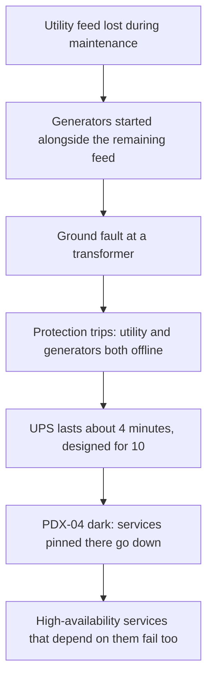

## The design that was meant to absorb this

For most of a day, and for some products close to two days, Cloudflare customers could not count on changing anything. The dashboard and the public API, which together make up what Cloudflare calls its control plane, failed or worked only in patches, and the analytics side (logs and reports) went with them [S1]. The trouble began at 11:43 UTC on 2 November 2023 and was fully resolved at 04:25 UTC on 4 November, roughly 41 hours [S1] [S1 §Some Products and Features Delayed Restart].

The part that kept working matters as much. The edge network that carries customer traffic and enforces security rules stayed up the whole time; what customers lost was the ability to manage it [S1]. Keep that split in mind, because it explains both why the outage was survivable and why it still hurt.

As a brief for a design review, the requirements are easy to state. Functionally, customers must be able to read and change their configuration, and their logs must reach them. Non-functionally, the system must keep doing that if any one facility disappears, without losing data.

Cloudflare's answer was geography plus redundancy. The control plane and analytics lived mostly in three data centers near Hillsboro, Oregon [S1 §Intended Design]. Running them active-active, with data kept in sync all the time so the others carry on when any one drops out, puts a ceiling on distance; disaster isolation puts a floor under it. The sites sat between the two: near enough for continuous sync, far enough apart that one flood or fire should not reach all of them, each with its own utility feeds and network links [S1 §Intended Design].

The plan had two known gaps, both chosen. Some services, mostly belonging to newer products, were still waiting to move onto that high-availability cluster [S1 §Intended Design]. And logging was left out on purpose. Logs already wait in queues at the edge before travelling to the core, so if the core logging site went dark, the reasoning went, analytics would simply arrive late, and late was acceptable [S1 §Intended Design].

The CEO, who signed the post, writes that the company believed this design covered exactly this case, a core provider failing badly, and would have kept customers unaffected [S1]. The rest of the case is about why it did not.

## One building, every power source gone

Cloudflare found out its data center had failed when its own routers there stopped answering, not from the operator [S1 §Attempting to Restore Power].

The building was PDX-04, the biggest of the three Oregon sites, run by Flexential. Cloudflare used about 10% of its capacity [S1 §Flexential Data Center Power Failure]. What it kept there is the important part: its biggest analytics cluster, a big share of the high-availability machines, and, by default, every service that had not yet joined the high-availability cluster [S1 §Flexential Data Center Power Failure]. So PDX-04 was one of three peers for some workloads and the only home for others.

The chain went roughly like this.

First the local utility, doing unplanned maintenance, knocked out one of the building's utility feeds. Flexential started its generators and ran them alongside the one live utility feed left, a combination Cloudflare calls unusual and has had no clear explanation for [S1 §Flexential Data Center Power Failure]. Flexential never mentioned the switch to generators. That silence cost the one window in which control-plane services could have been moved off the site; Cloudflare's monitoring watched servers, not where their power came from [S1 §Flexential Data Center Power Failure].

Next, a ground fault hit a utility transformer at the site. The protection systems did their job and cut power, and in doing so took the generators offline as well, leaving the building with no utility and no generators at once [S1 §Informed Speculation On What Happened Next].

That left the batteries. The UPS bank exists to cover the gap until generators come up, and it was sized for about 10 minutes. Judging by when its own servers dropped, Cloudflare reports the batteries started giving out after roughly 4 [S1 §Informed Speculation On What Happened Next]. Bringing the generators back took far longer than either figure. According to what staff told Cloudflare, they had to be restarted by hand on site, the door access system had no battery backup, and the night shift had no experienced electrical or operations engineer on it [S1 §Attempting to Restore Power].

A caution for anyone retelling this: S1 labels much of the power sequence as informed speculation, pieced together from what it observed and from unofficial accounts, because the operator had not confirmed the root cause when the post was written [S1 §Informed Speculation On What Happened Next]. The order of events is reasonable. The causes inside the building are not settled.

None of this is exotic. Each step is a known failure mode with a known mitigation. What turned it into a long outage is that the steps lined up, and that the one warning that could have bought time, the switch to generators, never reached the customer.

## Why the high-availability cluster still went down

Losing PDX-04 was a scenario Cloudflare had planned for. Its expectation was specific: analytics would go offline, logs would pile up on edge servers and arrive late, and a few low-priority services that never joined the high-availability cluster would stay down until rebuilt somewhere else [S1 §Designing for Data Center Level Failure]. The surviving sites would carry the cluster, and for the most part they did [S1 §Designing for Data Center Level Failure].

The surprise came from the services everyone counted as the safe ones. Code in the redundant cluster called Kafka and ClickHouse, the systems behind log processing and analytics, and those two had no copy outside PDX-04 [S1 §Designing for Data Center Level Failure]. When the building went dark, the "highly available" services failed along with the things they needed. S1 treats the coupling itself as the error, not the power loss [S1 §Designing for Data Center Level Failure].

This is the bottleneck of the whole case, and it is not hardware. It is an undeclared dependency on one facility.

The one test never run was the whole building: PDX-04 switched off in full [S1 §Designing for Data Center Level Failure]. Every other combination had been tried, each of the other Oregon sites alone and together, plus the redundant slice inside PDX-04. The tests matched the design, not the reality. A dependency that only exists between the redundant part and the non-redundant part of the same building survives every one of those tests.

There was a process gap behind the technical one. Teams could ship a new product to general availability without first moving its backend onto the high-availability cluster; the intention was to migrate later, and nothing enforced it [S1 §Designing for Data Center Level Failure]. The result was protection that varied product by product, which is hard to see from any single team's view.

The last point is architectural. Too many services needed the core facilities at all, even though Cloudflare's distributed edge kept working throughout the incident [S1 §Designing for Data Center Level Failure]. The company sells distributed systems for a living, yet parts of its own control plane were built like an ordinary centralised app.

## Failing over to Europe, then rebuilding from cold

Most customers were back in business the same day. Getting everything back took until early on 4 November [S1 §Disaster Recovery] [S1 §Some Products and Features Delayed Restart].

When Flexential restored power, it brought circuits back one by one, as is normal, and found that the breakers on Cloudflare's circuits were faulty. More had failed than the site had spares for, so replacements had to be sourced [S1 §Disaster Recovery]. With more services down than planned and no restoration time from the operator, Cloudflare switched to its disaster recovery sites in Europe. Only a small slice of the control plane needed to move; the bulk already ran on the redundant systems at the surviving Oregon sites [S1 §Disaster Recovery].

Turning the Europe sites on created a second incident in miniature. Every failed API call came back as a retry at the same moment, a thundering herd that overwhelmed the newly started services until rate limits brought the volume down. Customers saw intermittent errors from the dashboard and API during that stretch [S1 §Disaster Recovery]. The DR site was also never designed to run some of the log processing, so that work had to wait for Oregon. A few systems needed manual configuration, and a few custom APIs stayed down until PDX-04 returned [S1 §Disaster Recovery].

Newer products fared worst. Their disaster recovery procedures had never been fully built or tested, so the team worked in parallel: standing them up on the DR sites, and moving them onto the high-availability cluster [S1 §Some Products and Features Delayed Restart].

Then came a judgment call worth studying. By the time the operator confirmed clean power, the team had been on the emergency all day. The CEO sent most people to rest and started the move back the next morning, accepting a later recovery in exchange for fewer tired mistakes [S1 §Some Products and Features Delayed Restart]. That is a real trade-off with both sides visible: hours of extra degradation for customers against the risk of turning one outage into two.

Rebuild order was dictated by dependencies: configuration management first, by hand, then everything else, partly in parallel [S1 §Some Products and Features Delayed Restart]. Nothing less than a full bootstrap was safe, because repeated power cycles had left server state unknown [S1 §Some Products and Features Delayed Restart].

What it cost, once it was over: most analytics survived because they are also stored in Europe, but datasets without an EU copy have permanent gaps, and customers using log push lost logs from most of the event [S1 §Some Products and Features Delayed Restart]. Keeping logging off the high-availability cluster had assumed delay. In this failure, part of it became loss.

## What changed, and what this case does not prove

Cloudflare's response was organisational first. It declared a "Code Orange", modelled on Google's practice of pulling engineers onto a crisis, and moved non-critical engineering work onto control-plane reliability [S1 §Lessons and Remediation]. S1 publishes its own remediation list, so this post does not add a lessons section of its own. In short, the plan is to make the control plane run from the edge even with every core data center down, require high-availability and a tested DR plan before any product reaches general availability, and run chaos tests that remove each core facility entirely [S1 §Lessons and Remediation].

Read the case for its mechanism, not its drama. The design on paper was sound: three sites, active-active, tested failover. It failed through drift between the paper design and the running system, a gap that only a test removing an entire site could have exposed.

The trade-offs cut both ways. Leaving logging outside the high-availability cluster was cheaper and simpler, and for delay it worked as intended; it did not anticipate loss. Letting teams reach general availability quickly sped up products and quietly multiplied the single points of failure.

Some cautions. This is a first-party post written within days, and the power story rests partly on speculation. The remediation list describes intent, not results. What the case does establish is narrow and useful: redundancy you have not removed in a test is a belief, not a property.
