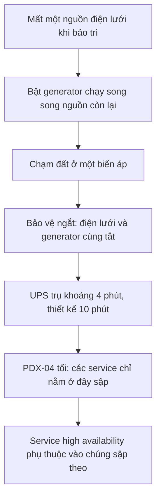

## Thiết kế lẽ ra phải chịu được chuyện này

Gần trọn một ngày, với vài sản phẩm là gần hai ngày, khách Cloudflare không chắc đổi được gì. Dashboard và API công khai, hai thứ hợp thành cái Cloudflare gọi là control plane, lúc lỗi lúc chạy, và phần analytics (log, báo cáo) cũng chung số phận [S1]. Sự cố bắt đầu lúc 11:43 UTC ngày 2/11/2023 và chỉ được xử lý xong lúc 04:25 UTC ngày 4/11, tức khoảng 41 giờ [S1] [S1 §Some Products and Features Delayed Restart].

Mạng edge, nơi traffic của khách đi qua và luật bảo mật được áp dụng, thì không sập; thứ khách mất là khả năng quản lý nó [S1].

Viết thành brief cho design review: về chức năng, khách phải đọc và đổi được cấu hình, và log phải tới được tay họ. Về phi chức năng, vẫn làm được như vậy khi mất bất kỳ một cơ sở nào, và không mất dữ liệu.

Câu trả lời của Cloudflare là địa lý cộng dự phòng. Control plane và analytics chủ yếu nằm ở ba data center gần Hillsboro, Oregon [S1 §Intended Design]. Muốn active-active, đồng bộ liên tục để rớt site nào các site kia vẫn gánh, thì không được đặt quá xa; muốn tránh chung thiên tai thì không được quá gần. Ba site nằm giữa hai giới hạn đó, mỗi nơi có điện lưới và đường mạng riêng [S1 §Intended Design].

Kế hoạch có hai lỗ hổng, cả hai đều biết trước. Một số service, chủ yếu của sản phẩm mới, chưa được đưa lên cụm high availability [S1 §Intended Design]. Còn logging thì cố ý để ngoài: log vốn đã xếp hàng ở edge trước khi về core, nên nếu site log ở core tắt thì analytics chỉ đến muộn, và muộn là chấp nhận được [S1 §Intended Design].

CEO, người ký bài, thừa nhận công ty tưởng thiết kế này đã tính đúng tình huống ấy, nhà cung cấp core hỏng nặng mà khách không hề hấn gì [S1]. Phần còn lại của câu chuyện là vì sao niềm tin đó sai.

## Một tòa nhà, mất sạch mọi nguồn điện

Cloudflare biết data center gặp nạn khi router của họ ở đó ngừng trả lời, không phải nhờ bên vận hành báo [S1 §Attempting to Restore Power].

Tòa nhà là PDX-04, lớn nhất trong ba site ở Oregon, do Flexential vận hành, và Cloudflare dùng khoảng 10% công suất của nó [S1 §Flexential Data Center Power Failure]. Đáng chú ý là thứ đặt ở đó: cụm analytics lớn nhất, một phần lớn máy của cụm high availability, và theo mặc định là mọi service chưa lên cụm high availability [S1 §Flexential Data Center Power Failure]. Với một số workload, PDX-04 là một trong ba site ngang hàng; với số khác, nó là chỗ duy nhất.

Chuỗi sự kiện đại khái như sau.

Đầu tiên, đợt bảo trì đột xuất của công ty điện cắt mất một đường điện lưới của tòa nhà. Flexential bật generator và chạy song song với nguồn lưới còn lại, một cách làm Cloudflare gọi là bất thường và chưa được giải thích rõ [S1 §Flexential Data Center Power Failure]. Flexential im lặng về chuyện này, và cái giá là mất đúng khoảng thời gian duy nhất có thể dời service control plane khỏi site; giám sát của Cloudflare nhìn server, không nhìn điện đến từ đâu [S1 §Flexential Data Center Power Failure].

Tiếp theo, một sự cố chạm đất xảy ra ở biến áp của công ty điện tại site. Hệ thống bảo vệ ngắt điện đúng như thiết kế, nhưng ngắt luôn cả generator, để tòa nhà mất cả hai nguồn cùng lúc [S1 §Informed Speculation On What Happened Next].

Chỉ còn ắc quy. Dàn UPS có nhiệm vụ lấp khoảng trống cho tới khi generator chạy, và được tính cho khoảng 10 phút. Dựa vào thời điểm server của chính mình tắt, Cloudflare cho biết ắc quy bắt đầu hỏng chỉ sau khoảng 4 phút [S1 §Informed Speculation On What Happened Next]. Bật lại generator mất lâu hơn nhiều: theo lời nhân viên, generator phải bật tay tại chỗ, hệ thống kiểm soát ra vào không có ắc quy dự phòng, và ca đêm không có kỹ sư điện hay vận hành nhiều kinh nghiệm [S1 §Attempting to Restore Power].

Lưu ý: S1 tự ghi phần lớn chuỗi sự kiện về điện là suy đoán có cơ sở, ghép từ quan sát và lời kể không chính thức, vì bên vận hành chưa xác nhận nguyên nhân gốc [S1 §Informed Speculation On What Happened Next].

Không bước nào lạ; bước nào cũng có cách giảm thiểu đã biết. Sự cố kéo dài vì chúng xếp thẳng hàng, và tín hiệu sớm duy nhất, việc chuyển sang generator, không tới tay khách.

## Vì sao cụm high availability vẫn sập

Mất PDX-04 là kịch bản Cloudflare đã tính. Dự kiến khá cụ thể: analytics tắt, log dồn ở edge và đến muộn, vài service ưu tiên thấp nằm ngoài cụm high availability tạm ngừng cho tới khi dựng lại chỗ khác [S1 §Designing for Data Center Level Failure]. Các site còn lại gánh cụm, và phần lớn đúng là vậy [S1 §Designing for Data Center Level Failure].

Bất ngờ đến từ chính những service tưởng an toàn nhất. Code trong cụm dự phòng gọi Kafka và ClickHouse, hai hệ xử lý log và analytics, mà hai hệ này không có bản nào ngoài PDX-04 [S1 §Designing for Data Center Level Failure]. Tòa nhà tối, các service "high availability" sập theo thứ chúng cần. S1 coi chính sự ràng buộc đó là lỗi, chứ không phải việc mất điện [S1 §Designing for Data Center Level Failure].

Đây là nút thắt của cả case: không phải phần cứng, mà là một phụ thuộc không khai báo vào một cơ sở duy nhất.

Bài test duy nhất chưa từng chạy là tắt nguyên tòa PDX-04 [S1 §Designing for Data Center Level Failure]. Mọi tổ hợp khác đều đã thử: từng site Oregon khác, các site đó cùng lúc, và phần high availability bên trong PDX-04. Test khớp với bản thiết kế, không khớp với thực tế. Một phụ thuộc chỉ tồn tại giữa phần dự phòng và phần không dự phòng của cùng một tòa nhà sẽ lọt qua mọi bài test ấy.

Team có thể đưa sản phẩm mới lên general availability mà chưa chuyển backend sang cụm high availability; ý định là chuyển sau, nhưng không gì bắt buộc [S1 §Designing for Data Center Level Failure]. Mức bảo vệ vì thế khác nhau theo sản phẩm, khó thấy nếu chỉ nhìn từ một team.

Điểm cuối thuộc về kiến trúc. Quá nhiều service cần đến core, trong khi mạng edge phân tán của Cloudflare vẫn chạy suốt sự cố [S1 §Designing for Data Center Level Failure]. Họ bán hệ phân tán, nhưng một phần control plane của chính họ lại dựng như ứng dụng tập trung.

## Failover sang châu Âu, rồi dựng lại từ con số không

Phần lớn khách hàng dùng lại được ngay trong ngày. Khôi phục toàn bộ thì phải tới rạng sáng 4/11 [S1 §Disaster Recovery] [S1 §Some Products and Features Delayed Restart].

Khi có điện lại, Flexential đóng từng mạch một như thường lệ, và phát hiện các breaker trên mạch của Cloudflare bị hỏng. Số hỏng nhiều hơn số dự phòng tại chỗ, nên phải đi tìm hàng thay [S1 §Disaster Recovery]. Service sập nhiều hơn dự kiến, bên vận hành không hứa được giờ khôi phục, nên Cloudflare failover sang các site disaster recovery ở châu Âu. Chỉ một phần nhỏ control plane cần dời đi; phần lớn đã chạy trên hệ high availability ở các site Oregon còn sống [S1 §Disaster Recovery].

Bật site châu Âu lên lại sinh ra sự cố thu nhỏ: mọi API call đang lỗi đồng loạt thử lại, thành thundering herd đè bẹp service vừa khởi động, cho tới khi rate limit kéo lưu lượng xuống. Trong lúc đó khách thấy lỗi lúc có lúc không trên dashboard và API [S1 §Disaster Recovery]. Site DR vốn không được thiết kế để chạy một phần việc xử lý log, nên phần đó phải chờ Oregon. Vài hệ cần cấu hình tay, và một số API riêng biệt nằm im cho tới khi PDX-04 trở lại [S1 §Disaster Recovery].

Sản phẩm mới chịu thiệt nhất: quy trình disaster recovery của chúng chưa từng được dựng đầy đủ hay thử, nên team làm song song: dựng chúng trên site DR, và chuyển chúng lên cụm high availability [S1 §Some Products and Features Delayed Restart].

Rồi đến một quyết định đáng học. Lúc điện được xác nhận sạch, team đã chạy sự cố cả ngày. CEO cho phần lớn mọi người đi nghỉ và để sáng hôm sau mới chuyển về, chấp nhận khôi phục muộn hơn để đổi lấy ít sai sót do mệt [S1 §Some Products and Features Delayed Restart]. Trade-off thấy rõ hai phía: khách chịu suy giảm thêm nhiều giờ, đổi lấy ít nguy cơ biến một sự cố thành hai.

Thứ tự dựng lại do phụ thuộc quyết định: quản lý cấu hình trước, làm tay, rồi mọi thứ khác, một phần chạy song song [S1 §Some Products and Features Delayed Restart]. Chỉ bootstrap toàn bộ mới an toàn, vì bật tắt nguồn nhiều lần đã khiến trạng thái server không ai biết [S1 §Some Products and Features Delayed Restart].

Cái giá sau cùng: phần lớn analytics còn nguyên nhờ có bản lưu ở châu Âu, nhưng dataset không có bản sao EU thì thủng vĩnh viễn, và khách dùng log push mất log của gần trọn sự cố [S1 §Some Products and Features Delayed Restart]. Để logging ngoài cụm high availability là giả định log chỉ chậm; lần này một phần thành mất.

## Cái đã đổi, và cái case này không chứng minh

Phản ứng đầu tiên là về tổ chức: Cloudflare tuyên bố "Code Orange", mô phỏng cách Google kéo kỹ sư vào xử lý khủng hoảng, và dồn các việc kỹ thuật không thiết yếu sang độ tin cậy của control plane [S1 §Lessons and Remediation]. S1 tự công bố danh sách khắc phục, nên bài này không thêm mục bài học riêng. Tóm gọn: cho control plane chạy từ edge kể cả khi mọi data center core cùng tắt, bắt buộc high availability và kế hoạch DR đã test trước khi sản phẩm lên general availability, và chạy chaos testing gỡ trọn từng cơ sở core [S1 §Lessons and Remediation].

Thiết kế trên giấy ổn: ba site, active-active, failover có test. Nó hỏng vì khoảng lệch giữa bản vẽ và hệ thống đang chạy, thứ chỉ bài test gỡ nguyên một site mới lộ ra.

Trade-off nào cũng hai mặt. Để logging ngoài cụm high availability thì rẻ và gọn, đúng với chuyện chậm nhưng không tính tới chuyện mất. Cho lên general availability nhanh thì ra sản phẩm sớm, nhưng lặng lẽ nhân thêm điểm hỏng đơn lẻ.

Đây là bài của chính công ty, viết vài ngày sau sự cố, phần về điện một phần là suy đoán, và danh sách khắc phục là ý định chứ chưa phải kết quả. Điều case này chứng minh thì hẹp nhưng hữu ích: dự phòng chưa từng bị gỡ ra trong một bài test chỉ là niềm tin, chưa phải đặc tính của hệ thống.
