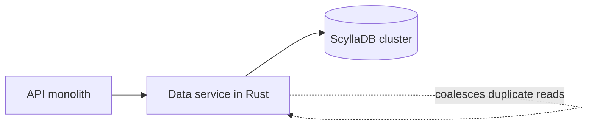

## Where the story starts

Every Discord message lands in one internal database, cassandra-messages [S1 §Our Cassandra Troubles]. Read as requirements, that gives two functional needs and three non-functional ones. Functionally, new messages must be written and a channel's history must come back fast when someone scrolls up. Non-functionally, there can be no downtime, latency has to be predictable, and the effort of operating the thing cannot grow in step with the data.

The size of the cluster is what turned this into a story. It ran 12 Cassandra nodes in 2017 [S1 §Our Cassandra Troubles]. By the start of 2022 it had 177, and the data had grown to trillions of messages [S1 §Our Cassandra Troubles]. More machines meant more toil: the on-call rotation was paged often, latency was erratic, and some maintenance jobs were scaled back because they had become too expensive to run [S1 §Our Cassandra Troubles].

Notice what the team was not asking for. Nobody wrote "make it faster" on the whiteboard. The goal, as I read it, was a cluster whose cost of operation stopped climbing at the same rate as the data. That goal is the reason there are two changes in this story and not one.

## What wore the Cassandra cluster down

If you run anything keyed by a busy entity, the first problem here will look familiar. Discord keys messages by channel plus a bucket, which is a fixed slice of time, and each such pair is stored together on three replicas [S1 §Our Cassandra Troubles]. Channel sizes are wildly uneven. A server of a few friends produces orders of magnitude less traffic than one with hundreds of thousands of members [S1 §Our Cassandra Troubles].

That unevenness produces the hot partition, the first bottleneck. A read in Cassandra is the expensive operation: it may have to check the memtable and then several SSTables on disk, whereas a write is only appended to the commit log and the memtable [S1 §Our Cassandra Troubles]. When a crowd opens one channel, a single partition takes the load and its node starts to fall behind. Every other query on that node suffers with it. Because reads and writes use quorum, any query that needs one of that partition's replicas slows down, and users feel it [S1 §Our Cassandra Troubles]. More nodes do not help. The hot data stays on the same few machines, so the cluster grows while the problem stays exactly where it was.

Maintenance is the second bottleneck, and it is quieter. Compaction kept falling behind, which made reads more expensive and let latency cascade while a node tried to catch up [S1 §Our Cassandra Troubles]. The team's remedy was a manual cycle they called the "gossip dance": take a node out of rotation so it can compact without traffic, bring it back so it can collect missed writes through hinted handoff, and repeat until the backlog is gone [S1 §Our Cassandra Troubles]. A third drain was the JVM. Garbage-collection pauses produced latency spikes, and some pauses came in such long runs that an operator had to restart the node by hand and nurse it back [S1 §Changing Our Architecture].

Here is the number that sums it up. Read p99 for historical messages swung between 40 and 125 ms, and insert p99 between 5 and 70 ms [S1 §Several Months Later…]. A spread that wide says the unlucky requests were unpredictable, which is worse for users than a steady, slightly slower service.

## Two changes, and why not one

Start with what the team gained from ScyllaDB, because it explains why the database change was attractive. ScyllaDB speaks Cassandra's protocol and is written in C++, so it has no garbage collector, and that absence was the part they valued [S1 §Changing Our Architecture]. Testing showed improvements, so they moved every database over, and by 2020 cassandra-messages was the only one left on Cassandra [S1 §Changing Our Architecture].

Why that one last? Its size made any move a big effort, and the team wanted more production experience with ScyllaDB first. There was also a technical blocker: reverse queries, which scan against a table's sort order, were too slow for them, and the ScyllaDB developers made it a priority to fix [S1 §Changing Our Architecture]. That is a cost to keep in mind when you pick a younger database: sometimes you are waiting on somebody else's roadmap.

The second change matters more. Discord did not trust a new database to cure the hot partition, since ScyllaDB can have them too, so it added protection in front of the database [S1 §Changing Our Architecture]. That protection is a set of data services written in Rust. They sit between the API monolith and the database clusters, expose roughly one gRPC endpoint per query, and deliberately contain no business logic [S1 §Data Services Serving Data].

Their main job is request coalescing. Duplicate concurrent reads for one row collapse into a single query whose result fans out to every waiter [S1 §Data Services Serving Data]. Under the hood, the first request starts a worker task and later requests subscribe to it [S1 §Data Services Serving Data]. An @everyone announcement in a huge server therefore stops being a pile of identical reads on one partition. Consistent hashing makes it work better: requests carry a routing key, which for messages is the channel ID, so every request for a channel reaches the same service instance [S1 §Data Services Serving Data].

This design has a price: one more service to run, and a layer that every read and write must pass through. What it buys is a hot partition that no longer scales with the number of curious users. It is not a full cure either, and the post says so. Hot partitions and elevated latency still appeared on the Cassandra cluster, just less often, and the layer mainly bought time to prepare the ScyllaDB cluster and the migration [S1 §Data Services Serving Data].

For your own reasoning, the useful split is this. The database swap addressed the runtime, the garbage collector. The data service addressed the access pattern, the concentrated reads. Those are different causes, and a team that fixes only one of them should expect only part of the improvement. It also means you cannot read the final numbers as a verdict on either change alone.

## The migration: three months estimated, nine days after the rewrite

The migration had two hard constraints: no downtime, and not too slow, since the old cluster still demanded frequent firefighting [S1 §A Very Big Migration]. The first plan optimised for early payoff. After a cutover time, new data would be served from ScyllaDB and history would be backfilled behind it. The team concedes that this made the plan more complicated [S1 §A Very Big Migration].

New writes went to both databases through a dual-write while the team set up the Spark-based migrator that ScyllaDB provides. Once tuned, it projected three months to finish [S1 §A Very Big Migration]. For a team already in firefighting mode, that is a long wait, and a long stretch of keeping two systems in agreement.

The way out was almost an accident of reuse. The team already owned a fast database library inside the data service, so they extended it into a migrator that reads token ranges, saves its progress in local SQLite checkpoints and writes straight into ScyllaDB [S1 §A Very Big Migration]. It took an afternoon. The projected duration fell to nine days, short enough that the time-based plan was dropped and everything moved at once [S1 §A Very Big Migration]. At its peak the tool copied up to 3.2 million rows per second [S1 §A Very Big Migration].

The failure story is worth a pause. The migration stalled just short of complete. The last token ranges held huge runs of tombstones never compacted in Cassandra, so the migrator's reads timed out until the team compacted them, and then it finished within seconds [S1 §A Very Big Migration]. If you have maintenance debt you have been ignoring, a migration is the moment it comes due.

Correctness was checked by mirroring a small share of reads to both databases and comparing the answers. The new cluster handled full production traffic while the old one produced ever more frequent latency problems, and that settled it: ScyllaDB became the primary [S1 §A Very Big Migration].

## After the cutover, and what the numbers do not prove

The switch happened in May 2022 [S1 §Several Months Later…]. Afterwards the post describes a quiet database, with no weekend-long firefights and no shuffling of nodes to keep it up [S1 §Several Months Later…]. The cluster went from 177 Cassandra nodes to 72 ScyllaDB nodes [S1 §Several Months Later…]. P99 for historical messages went from 40–125 ms to 15 ms, and insert p99 from 5–70 ms to a steady 5 ms [S1 §Several Months Later…]. Both gains are in the tail rather than the average, which fits the project: the aim was to make the bad requests less bad.

Read these figures with the right amount of caution. They are a first-party account written by the people who did the work, so they show that the combination of ScyllaDB, a coalescing data service and a fast migrator worked for this workload. They do not show that ScyllaDB beats Cassandra in general, because the post never separates the gain from the database from the gain from coalescing. If you are deciding whether to copy any of this, ask which of the two causes you actually have, a runtime problem or an access-pattern problem, and test that before buying either remedy.

The write-up is also honest about the limits of the new database. S1 says plainly that ScyllaDB has its own problems; what they valued was the absence of a garbage collector [S1 §Changing Our Architecture]. That is a more useful lesson than "pick the faster database": choose the one whose failure modes your team understands, then put protection in front of it.
