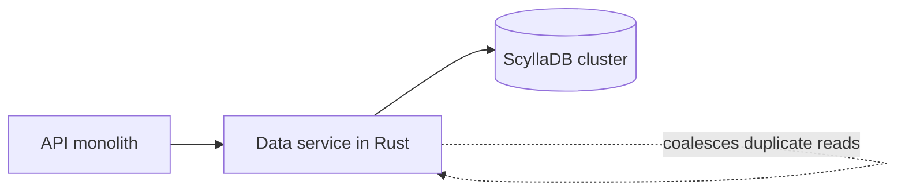

## Where the story starts

Discord kept every message in an internal database called cassandra-messages [S1 §Our Cassandra Troubles]. Read as requirements, that means the following. Functionally: write new messages, and read a channel's history back fast when someone scrolls up. Non-functionally: no downtime, latency you can predict, and an operations load that does not grow with the data.

In 2017 the cluster had 12 Cassandra nodes [S1 §Our Cassandra Troubles]. By the start of 2022 it had 177 and held trillions of messages [S1 §Our Cassandra Troubles]. That is the scale of the problem: the machine count multiplied, and so did the work of keeping them healthy. The on-call rotation was paged often, latency was erratic, and some maintenance jobs were trimmed back because running them had become too costly [S1 §Our Cassandra Troubles].

Read as a goal, the team did not want "faster" in the abstract. They wanted a cluster whose operating cost stopped rising at the same rate as the data. That goal explains why they did two things instead of one.

## What wore the Cassandra cluster down

Messages are keyed by channel plus a bucket, a fixed slice of time, so everything for one channel and bucket lives together on three replicas [S1 §Our Cassandra Troubles]. The catch is the spread of channel sizes: a small friends' server produces orders of magnitude less traffic than one with hundreds of thousands of members [S1 §Our Cassandra Troubles].

The first bottleneck is the hot partition. In Cassandra a read costs more than a write: a write is appended to a commit log and an in-memory table, while a read may need the in-memory table and several files on disk [S1 §Our Cassandra Troubles]. When a crowd reads one channel at once, a single partition absorbs the load, its node falls behind, and neighbouring queries on that node slow down too. Reads and writes go through quorum, so every query that needs one of the replicas of that partition gets slower, and users notice [S1 §Our Cassandra Troubles]. Adding nodes does not help, since the hot data stays on the same few machines.

The second bottleneck is maintenance. Compaction regularly lagged, which made reads costlier and let latency cascade while a node tried to catch up [S1 §Our Cassandra Troubles]. The workaround was a manual cycle the team nicknamed the "gossip dance": rotate a node out so it can compact without serving traffic, rotate it back in to receive its missed writes, and repeat until the backlog clears [S1 §Our Cassandra Troubles]. JVM tuning ate more time, since garbage-collection pauses produced latency spikes, and some pauses chained together until an operator had to restart the node by hand and nurse it back [S1 §Changing Our Architecture].

From outside, read p99 for historical messages swung between 40 and 125 ms, and insert p99 between 5 and 70 ms [S1 §Several Months Later…]. A range that wide means the unlucky reads were hard to predict. Behind those numbers, the on-call team was paged frequently for database issues [S1 §Our Cassandra Troubles].

## Two changes, and why not one

ScyllaDB had been on the team's radar for a while. It speaks Cassandra's protocol, is written in C++ and has no garbage collector, which was the part they cared about most [S1 §Changing Our Architecture]. After testing showed improvements, they decided to move every database, and by 2020 only cassandra-messages was left on Cassandra [S1 §Changing Our Architecture].

They had held off on this last cluster for understandable reasons: its size, and a wish to gain production experience with ScyllaDB first. Testing also showed that reverse queries, which scan against a table's sort order, were too slow for them, and the ScyllaDB developers made fixing that a priority [S1 §Changing Our Architecture]. There is a cost hidden here: a younger database can leave you waiting on someone else's roadmap.

More important, they did not expect a new database to fix things alone. ScyllaDB can have hot partitions too, so they put protection upstream of it [S1 §Changing Our Architecture]. That protection is the data service, a Rust layer between the API monolith and the database clusters. It is thin on purpose: roughly one gRPC endpoint per query and no business logic [S1 §Data Services Serving Data].

The service's main job is request coalescing. When many users ask for the same row together, only one database query goes out: the first request starts a worker task, later requests attach to that task, and its result is handed to all of them [S1 §Data Services Serving Data]. An @everyone ping in a huge server therefore stops being a pile of identical reads on one partition. Routing helps it work: requests are hashed to an instance by a routing key, which for messages is the channel ID, so one channel always lands on the same instance [S1 §Data Services Serving Data].

The trade-off is one more service to run, and a middle layer that every request passes through. In return, the load reaching a hot partition is no longer proportional to the number of curious users. The post itself says this does not solve everything: they still saw hot partitions and higher latency on the Cassandra cluster, only less often, and the changes bought time to prepare the ScyllaDB cluster and run the migration [S1 §Data Services Serving Data].

## The migration: three months estimated, nine days after the rewrite

The constraints were simple: move trillions of messages without downtime, and finish soon, because the Cassandra cluster was still demanding constant firefighting [S1 §A Very Big Migration]. The first plan aimed to pay off early: serve newer data from ScyllaDB after a cutover timestamp and backfill history afterwards. The team concedes this was more complicated [S1 §A Very Big Migration].

New writes went to both databases while the team set up the Spark-based migrator that ScyllaDB provides. After a lot of tuning, it projected three months to finish [S1 §A Very Big Migration]. For a team already firefighting, that is a long wait, and a long time to keep two systems in agreement.

Then someone remembered that the team already had a fast database library for the data service. They extended it into a migrator that reads token ranges, keeps its progress in local SQLite checkpoints and writes straight into ScyllaDB [S1 §A Very Big Migration]. That took one afternoon. The new estimate was nine days, fast enough that they dropped the time-based plan and moved everything at once [S1 §A Very Big Migration]. At its peak it copied up to 3.2 million rows per second [S1 §A Very Big Migration].

The failure worth keeping: the migration stalled just short of complete. The last token ranges held years of uncompacted tombstones in Cassandra, so the migrator's reads timed out until the team compacted them, after which it finished within seconds [S1 §A Very Big Migration]. Maintenance debt you ignore for years comes due at the very end.

To check correctness, the team mirrored a small share of reads to both databases and compared answers. The new cluster coped with full production traffic while Cassandra's latency problems kept getting more frequent, so they promoted ScyllaDB to primary [S1 §A Very Big Migration].

## After the cutover, and what the numbers do not prove

The team switched the messages database over in May 2022 [S1 §Several Months Later…]. Since then the post reports a quiet database, with no weekend-long firefights and no juggling nodes to keep it up. The cluster went from 177 Cassandra nodes to 72 ScyllaDB nodes [S1 §Several Months Later…]. P99 for historical messages went from 40–125 ms to 15 ms, and insert p99 from 5–70 ms to a steady 5 ms [S1 §Several Months Later…]. Both gains are in the tail, not the average: the project made the bad reads less bad.

This is an account by the people who did the work, so read it as that. The numbers show that the combination of ScyllaDB, a data service and a fast migrator worked for this workload. They do not show that ScyllaDB is faster than Cassandra in general. The post also does not separate how much of the improvement came from the database and how much from coalescing. Treat it as a case, not a benchmark.

One more point is easy to miss: the post does not claim ScyllaDB is trouble-free, only that it has no garbage collector [S1 §Changing Our Architecture]. Discord's win was not finding a perfect database. It was choosing one whose failure modes the team understands, then building protection in front of it.
