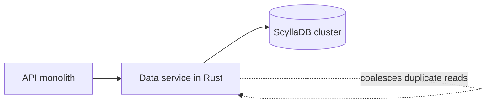

## Where the story starts

Discord kept every message in an internal database called cassandra-messages. The functional requirement is simple: write new messages, and read a channel's history back fast when someone scrolls up. The non-functional requirements are where it gets hard: no downtime, predictable latency, and an operations load that does not grow with the amount of data [S1 §Our Cassandra Troubles].

In 2017 the cluster had 12 Cassandra nodes [S1 §Our Cassandra Troubles]. At the start of 2022 it had 177 nodes and trillions of messages [S1 §Our Cassandra Troubles]. That is the scale of the problem: the machine count multiplied, and the toil grew with it. The post calls it a high-toil system. The on-call team was paged frequently for database issues, latency was unpredictable, and the team had to cut down on maintenance operations that had become too expensive to run [S1 §Our Cassandra Troubles].

The goal was not "faster" in the abstract. They wanted a cluster whose operating cost did not rise at the same rate as the data. Keep that goal in mind, because it explains why they did two things instead of one.

## What wore the Cassandra cluster down

To see the problem you need to see how messages are stored. Discord partitions messages by channel plus a bucket, which is a fixed time window, so all messages for a channel and bucket sit together and are replicated across three nodes [S1 §Our Cassandra Troubles]. The post points out the trap in that layout: a server of a few friends sends orders of magnitude fewer messages than a server with hundreds of thousands of people [S1 §Our Cassandra Troubles].

The first bottleneck is the hot partition. In Cassandra reads are more expensive than writes, because a write only appends to a commit log and a memtable, while a read has to consult the memtable and possibly several SSTables on disk [S1 §Our Cassandra Troubles]. When many people read the same channel at once, one channel and bucket pair receives a large amount of traffic. The node serving it tries harder and falls further behind, and other queries on that node slow down too. Because the team reads and writes at quorum, every query that touches the nodes holding the hot partition gets slower, and end users feel it [S1 §Our Cassandra Troubles]. Adding nodes does not fix this, since the hot data still lives on the same few of them.

The second bottleneck is maintenance. The cluster often fell behind on compactions, which makes reads more expensive and spreads latency as a node struggles to compact [S1 §Our Cassandra Troubles]. The team had a routine for it called the "gossip dance": take a node out of rotation so it can compact without traffic, bring it back to pick up hints from hinted handoff, and repeat until the compaction backlog is empty [S1 §Our Cassandra Troubles]. On top of that they spent a lot of time tuning the JVM garbage collector and heap, because GC pauses caused latency spikes. Some pauses ran back to back for so long that an operator had to reboot the node by hand and babysit it back to health [S1 §Changing Our Architecture].

What it looked like from outside: read p99 for historical messages swung between 40 and 125 ms, and insert p99 between 5 and 70 ms [S1 §Several Months Later…]. A range that wide means the unlucky reads were hard to predict. And that is only the visible part. The rest is people: engineers woken up to look after machines that were not broken, only unhappy.

## Two changes, and why not one

The team already had a reason to try ScyllaDB. It had caught their eye earlier because it is Cassandra-compatible and written in C++, and it promised better performance, faster repairs, stronger workload isolation through a shard-per-core architecture, and a life without garbage collection [S1 §Changing Our Architecture]. They experimented, saw improvements in testing, and decided to migrate every database. By 2020 all of them had moved except cassandra-messages [S1 §Changing Our Architecture].

The reasons for waiting are clear too: the cluster was huge, and they wanted production experience with ScyllaDB first. They also found that ScyllaDB's reverse queries were too slow for their needs, and the ScyllaDB team prioritised the fix [S1 §Changing Our Architecture]. That is a cost worth remembering: picking a newer database can mean waiting for the vendor to fix the thing you need.

More important is that they did not believe a new database alone would be enough. Hot partitions can still happen on ScyllaDB, so they invested in the systems upstream to shield it [S1 §Changing Our Architecture]. The result is the data service: intermediary services between the API monolith and the database clusters, written in Rust, with roughly one gRPC endpoint per query and intentionally no business logic [S1 §Data Services Serving Data].

Their main feature is request coalescing. If several users request the same row at the same time, the service queries the database once: the first request spins up a worker task, later requests find that task and subscribe to it, and the task returns the row to every subscriber [S1 §Data Services Serving Data]. A big @everyone announcement on a large server no longer turns into a pile of identical reads against one partition. To make coalescing effective, requests are also routed by consistent hashing: for messages the routing key is the channel ID, so all requests for a channel reach the same instance [S1 §Data Services Serving Data].

The trade-off is one more service to run, and a middle layer that every request passes through. In return, the load reaching a hot partition is no longer proportional to the number of curious users. The post itself says this does not solve everything: they still saw hot partitions and higher latency on the Cassandra cluster, only less often, and the changes bought time to prepare the ScyllaDB cluster and run the migration [S1 §Data Services Serving Data].

## The migration: three months estimated, nine days after the rewrite

The migration requirements were plain: move trillions of messages with no downtime, and do it quickly, because Cassandra was still forcing the team to firefight [S1 §A Very Big Migration]. The first plan was designed to deliver value early: use the new ScyllaDB cluster for new data from a cutover time, then migrate historical data behind it. The team admits that this adds complexity [S1 §A Very Big Migration].

They started dual-writing new data to both Cassandra and ScyllaDB and set up ScyllaDB's Spark migrator. It needed a lot of tuning, and once it ran, the estimated time to completion was three months [S1 §A Very Big Migration]. That is too long for a team firefighting every week, and too long to carry the risk of two systems that must stay in step.

The team sat down and remembered they already had a fast database library. They extended their data service library to do large-scale migrations: read token ranges from a database, checkpoint them locally in SQLite, and firehose them into ScyllaDB [S1 §A Very Big Migration]. It took an afternoon. The new estimate was nine days, and since it was that fast, they dropped the complicated time-based approach and moved everything at once [S1 §A Very Big Migration]. The migrator ran at up to 3.2 million messages per second [S1 §A Very Big Migration].

There is a failure story here that every plan should keep. Several days in, when the team gathered to watch progress hit 100%, it was stuck just short. The migrator timed out reading the last few token ranges, because they contained huge ranges of tombstones that had never been compacted away in Cassandra. They compacted that range, and seconds later the migration was done [S1 §A Very Big Migration]. Maintenance debt you ignore for years collects at the very end.

For verification, the team automatically sent a small percentage of reads to both databases and compared the results. The new cluster held up under full production traffic while Cassandra suffered increasingly frequent latency problems. Then they made ScyllaDB the primary database [S1 §A Very Big Migration].

## After the cutover, and what the numbers do not prove

The team switched the messages database over in May 2022 [S1 §Several Months Later…]. The post describes the result as a quiet, well-behaved database: no more weekend-long firefights, no more juggling nodes to preserve uptime. The cluster went from 177 Cassandra nodes to 72 ScyllaDB nodes [S1 §Several Months Later…]. P99 for fetching historical messages went from 40–125 ms to 15 ms, and insert p99 went from 5–70 ms to a steady 5 ms [S1 §Several Months Later…]. Both improvements are in the tail, not the average. The point of the project was to make the bad reads less bad.

This is an account by the people who did the work, so read it as that. The numbers show that the combination of ScyllaDB, a data service and a fast migrator worked for this workload. They do not show that ScyllaDB is faster than Cassandra in general. The post also does not separate how much of the improvement came from the database and how much from coalescing. Treat it as a case, not a benchmark.

One more detail is easy to miss: the post itself says ScyllaDB is "most definitely not void of issues" [S1 §Changing Our Architecture]. Discord's win was not finding a perfect database. It was choosing one whose failure modes the team understands, then building protection in front of it.
