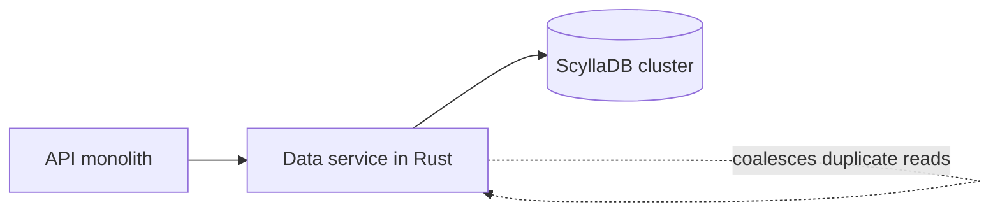

## Where the story starts

By early 2022, one database at Discord was costing its engineers sleep. Some routine upkeep had already been dropped because the team could no longer afford to run it, its latency moved around with no warning, and the on-call rotation kept getting paged on its account [S1 §Our Cassandra Troubles]. That database had grown to 177 Cassandra nodes holding trillions of messages [S1 §Our Cassandra Troubles]. Back in 2017 the same work took 12 nodes [S1 §Our Cassandra Troubles].

Every message sent on Discord ends up in it; internally it is called cassandra-messages [S1 §Our Cassandra Troubles].

Turned into a design-review brief, the asks are short. The system must accept new messages and return a channel's history quickly when someone scrolls back. Around that sit the operational asks: no downtime, predictable latency, and a running cost that does not rise in lockstep with the data.

As I read the case, that last ask is the real goal, more than raw speed, and it explains why the story ends with two fixes instead of one.

## What wore the Cassandra cluster down

Start with the baseline the team later measured against. On Cassandra, p99 for fetching historical messages sat anywhere from 40 to 125 ms, and p99 for inserting a message anywhere from 5 to 70 ms [S1 §Several Months Later…]. To a user, a spread that wide feels random, and random is harder to live with than steadily slow.

The spread had more than one cause, and the causes made each other worse.

The first is about where data lives. Cassandra stores each partition on several replicas, and Discord's partition key is a channel plus a bucket, a fixed window of time [S1 §Our Cassandra Troubles]. Channel traffic varies by orders of magnitude, from a few friends chatting to huge public communities [S1 §Our Cassandra Troubles]. A crowd opening one popular channel generates reads. Each of those reads may have to search several SSTables on disk on top of the memtable, so the crowd costs far more by reading than by posting, since a new message is only a commit-log append and a memtable write [S1 §Our Cassandra Troubles]. All of that cost lands on the few nodes holding the hot partition's replicas.

The damage does not stay inside that channel. Discord uses quorum for reads and writes alike, so users in quiet channels end up waiting too, whenever their quorum includes one of the overloaded replicas [S1 §Our Cassandra Troubles]. That is the hot partition. Buying more nodes does not dilute it, because the hot key still maps to the same replicas.

The second cause is housekeeping that never got enough room. Cassandra needs time to merge SSTables (compaction) and the JVM needs time to collect garbage; on this cluster, both had to steal that time from user traffic. Catch-up compaction dragged on latency around whichever node ran it, and every SSTable still waiting to be merged was one more file a read had to check [S1 §Our Cassandra Troubles]. GC pauses produced spikes of their own. At worst a node needed a person: a manual reboot and careful watching, after its GC pauses had chained together for too long [S1 §Changing Our Architecture].

The compaction workaround shows how much human effort this consumed. The team called it the "gossip dance", and it traded serving capacity for compaction time. Engineers rotated through the cluster, giving each node a quiet spell to compact while hinted handoff held on to the writes it missed, and stopped only when compaction had caught up [S1 §Our Cassandra Troubles]. None of that work improves the product. It only keeps the cluster where it was.

## Two changes, and why not one

Part of the fix had to live above the database, because hot partitions come from the access pattern and ScyllaDB is not immune to them [S1 §Changing Our Architecture].

That part is a layer of data services written in Rust. The API monolith calls them instead of calling the database directly. Their interface is thin on purpose: each gRPC endpoint maps more or less to one database query, and product rules are kept out of them entirely [S1 §Data Services Serving Data].

What they exist for is request coalescing. The database answers once per row, no matter how many identical requests are waiting for it. Under the hood that is one worker task per row in flight, with every duplicate request parked on that task until its result comes back [S1 §Data Services Serving Data]. That is how an @everyone ping in a huge server becomes one read instead of a flood of identical reads on one partition.

Duplicates can only be merged if they land in the same process. So requests are spread across instances by consistent hashing on the channel ID, which means one channel always talks to one instance [S1 §Data Services Serving Data].

The price is plain: one more service to deploy and to be paged for, and an extra hop on every read and write. Discord does not oversell what it got back. The layer mainly delivered time, enough to build the ScyllaDB cluster and plan the move, while Cassandra kept having hot partitions and latency bumps, only less often [S1 §Data Services Serving Data].

The database change, meanwhile, was mostly about the garbage collector. ScyllaDB speaks Cassandra's protocol but is written in C++, so there is no GC to stall a node, and that is the property the team cared about [S1 §Changing Our Architecture]. By 2020 every other Discord database was already on ScyllaDB, a move made after testing showed gains; only cassandra-messages remained [S1 §Changing Our Architecture].

The holdout had a concrete blocker. Discord's message scans include reverse queries, which read against a table's sort order, and ScyllaDB ran them too slowly in testing until its developers made the fix a priority [S1 §Changing Our Architecture]. The team also wanted more production mileage with ScyllaDB before touching its largest cluster, one big enough that any move would be a project of its own [S1 §Changing Our Architecture]. That is the hidden cost of a younger database: your schedule can end up depending on someone else's roadmap.

Keep the fixes apart in your head. The database swap removed a runtime problem, the GC pauses. The data service removed an access-pattern problem, identical reads converging on one partition. A team with only one of those problems should expect only one of the gains.

## The migration: three months estimated, nine days after the rewrite

Rewriting the copy tool turned a three-month estimate into a nine-day one [S1 §A Very Big Migration]. It also reshaped the plan.

Firefighting on the Cassandra cluster had eased but not stopped, and that set the rules: move fast, and never take the service down [S1 §A Very Big Migration]. The first plan accepted extra complexity, which the team admits, in exchange for early value. Data newer than a chosen cutover time would live on ScyllaDB right away, with older history backfilled later [S1 §A Very Big Migration].

Three months was what ScyllaDB's own Spark-based migrator projected for that backfill, and only after heavy tuning; dual-write kept new messages flowing to both clusters in the meantime [S1 §A Very Big Migration]. For a team still fighting fires, that is a long time to keep two databases in agreement.

The replacement migrator was an afternoon's work, because the data service library was already a fast database client [S1 §A Very Big Migration]. Rows go from Cassandra to ScyllaDB one token range at a time, with each finished range recorded in a local SQLite checkpoint [S1 §A Very Big Migration]. The age-based split was abandoned and everything moved in one go, since a nine-day job no longer justified the extra complexity [S1 §A Very Big Migration]. Throughput peaked at 3.2 million rows per second [S1 §A Very Big Migration].

The last step of the migration was not copying but compaction. Seconds after the team compacted the final token ranges, the job finished; until then it had sat just short of done, with the migrator timing out on a backlog of deletion markers (tombstones) that Cassandra had never cleaned up [S1 §A Very Big Migration]. Notice the link back to the compaction trouble above. If you have been skipping maintenance, a migration is when the bill arrives.

Correctness was checked by comparison: both databases answered a small sample of the same reads, and the answers had to match. The deciding evidence came from both sides at once. Cassandra's latency incidents were becoming more frequent, while ScyllaDB was coping with production load without that trouble, so ScyllaDB was promoted to primary [S1 §A Very Big Migration].

## After the cutover, and what the numbers do not prove

Fewer machines, tighter tails. The workload that needed 177 Cassandra nodes now runs on 72 ScyllaDB nodes [S1 §Several Months Later…]. Inserts settled at a flat p99 of 5 ms, down from 5–70 ms, and reads of old messages at 15 ms, down from 40–125 ms [S1 §Several Months Later…]. ScyllaDB took over as the messages database in May 2022 [S1 §Several Months Later…].

The team leads with the operational change. Nobody has to move nodes around to keep the cluster alive any more, and weekends stay free; the source's own word for the result is quiet [S1 §Several Months Later…]. Both latency gains are in the tail rather than the average, which fits the goal from the start: fewer bad requests and fewer bad nights, not a faster median.

Read these figures with some caution. This is a first-party account: it shows that ScyllaDB plus a coalescing data service worked for this workload. It does not show that ScyllaDB beats Cassandra in general, because the post never separates the gain from the database from the gain from coalescing. Before copying any of it, work out which cause you actually have, runtime or access pattern.

The property the team singles out is the missing garbage collector, and S1 is careful not to claim more: ScyllaDB comes with problems of its own [S1 §Changing Our Architecture]. That makes a better rule than "pick the faster database": pick the one whose failure modes your team understands, then put protection in front of it.
