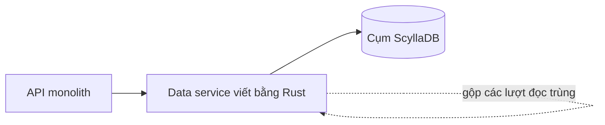

## Nơi câu chuyện bắt đầu

Mọi tin nhắn của Discord nằm trong một database nội bộ tên là cassandra-messages [S1 §Our Cassandra Troubles]. Đọc thành yêu cầu, ta có hai nhu cầu chức năng và ba nhu cầu phi chức năng. Về chức năng: ghi tin nhắn mới, và trả lịch sử một kênh thật nhanh khi ai đó cuộn lên. Về phi chức năng: không downtime, độ trễ dự đoán được, và công sức vận hành không được tăng cùng nhịp với dữ liệu.

Kích thước của cụm là thứ biến chuyện này thành một câu chuyện. Năm 2017 nó chạy 12 node Cassandra [S1 §Our Cassandra Troubles]. Đến đầu năm 2022 là 177 node, và dữ liệu đã lên tới hàng nghìn tỷ tin nhắn [S1 §Our Cassandra Troubles]. Nhiều máy hơn đồng nghĩa với nhiều toil hơn: on-call bị page thường xuyên, độ trễ thất thường, và một số việc bảo trì phải giảm bớt vì chạy chúng đã quá tốn kém [S1 §Our Cassandra Troubles].

Hãy để ý điều đội không đòi hỏi. Không ai ghi "làm cho nhanh hơn" lên bảng. Mục tiêu, theo cách tôi đọc, là một cụm mà chi phí vận hành thôi tăng cùng tốc độ với dữ liệu. Mục tiêu đó là lý do câu chuyện này có hai thay đổi chứ không phải một.

## Cái gì làm cụm Cassandra mệt

Nếu bạn từng chạy thứ gì đó khóa theo một thực thể đông khách, vấn đề đầu tiên ở đây sẽ quen thuộc. Discord khóa tin nhắn theo kênh cộng một bucket, tức một lát thời gian cố định, và mỗi cặp như vậy được lưu cùng nhau trên ba replica [S1 §Our Cassandra Troubles]. Kích thước các kênh chênh lệch rất lớn. Server của vài người bạn tạo ra lượng traffic nhỏ hơn nhiều bậc so với server có hàng trăm nghìn thành viên [S1 §Our Cassandra Troubles].

Sự chênh lệch đó sinh ra hot partition, nút thắt đầu tiên. Trong Cassandra, đọc mới là thao tác đắt: nó có thể phải xem memtable rồi nhiều SSTable trên đĩa, còn ghi chỉ được nối vào commit log và memtable [S1 §Our Cassandra Troubles]. Khi một đám đông mở cùng một kênh, một partition gánh hết tải và node của nó bắt đầu tụt lại. Mọi query khác trên node đó chịu chung. Vì đọc và ghi dùng quorum, bất kỳ query nào cần một replica của partition ấy đều chậm đi, và người dùng cảm nhận được [S1 §Our Cassandra Troubles]. Thêm node không giúp. Dữ liệu nóng vẫn nằm trên cùng vài máy đó, nên cụm lớn lên còn vấn đề đứng nguyên chỗ cũ.

Bảo trì là nút thắt thứ hai, và nó âm thầm hơn. Compaction liên tục bị trễ, khiến đọc đắt hơn và để độ trễ lan dây chuyền khi node cố bắt kịp [S1 §Our Cassandra Troubles]. Cách chữa của đội là một chu trình thủ công gọi là "gossip dance": đưa node ra khỏi rotation để nó compact mà không có traffic, đưa lại để nó thu các ghi bị lỡ qua hinted handoff, rồi lặp đến khi hết backlog [S1 §Our Cassandra Troubles]. Nguồn hao tổn thứ ba là JVM. GC pause tạo ra các đỉnh độ trễ, và có những pause nối đuôi nhau lâu đến mức operator phải tự restart node rồi chăm nó hồi phục [S1 §Changing Our Architecture].

Con số sau đây tóm tắt tất cả. P99 khi đọc tin nhắn cũ dao động giữa 40 và 125 ms, còn p99 khi insert dao động giữa 5 và 70 ms [S1 §Several Months Later…]. Biên độ rộng như vậy nghĩa là các request kém may mắn không dự đoán được, và với người dùng điều đó tệ hơn một dịch vụ ổn định nhưng chậm hơn một chút.

## Hai thay đổi, và vì sao không chỉ một

Hãy bắt đầu từ cái đội được lợi ở ScyllaDB, vì nó giải thích sức hấp dẫn của việc đổi database. ScyllaDB nói cùng giao thức với Cassandra và viết bằng C++, nên không có garbage collector, và sự vắng mặt đó là phần họ coi trọng [S1 §Changing Our Architecture]. Thử nghiệm cho thấy cải thiện, nên họ chuyển mọi database sang, và đến năm 2020 cassandra-messages là cái duy nhất còn ở lại Cassandra [S1 §Changing Our Architecture].

Vì sao để cái đó lại sau cùng? Kích thước khiến mọi cuộc chuyển đều là một nỗ lực lớn, và đội muốn có thêm kinh nghiệm chạy ScyllaDB trên production trước. Còn có một chướng ngại kỹ thuật: reverse query, tức quét ngược thứ tự sắp xếp của bảng, quá chậm với họ, và các developer của ScyllaDB đã ưu tiên sửa nó [S1 §Changing Our Architecture]. Đó là một cái giá cần nhớ khi chọn database trẻ hơn: đôi khi bạn đang chờ lộ trình của người khác.

Thay đổi thứ hai quan trọng hơn. Discord không tin một database mới sẽ chữa được hot partition, vì ScyllaDB cũng có thể gặp, nên họ dựng thêm lớp bảo vệ phía trước database [S1 §Changing Our Architecture]. Lớp đó là các data service viết bằng Rust. Chúng nằm giữa API monolith và các cụm database, mở khoảng một gRPC endpoint cho mỗi query, và cố ý không chứa business logic [S1 §Data Services Serving Data].

Việc chính của chúng là request coalescing. Các lượt đọc trùng đồng thời cho cùng một hàng được gộp thành một query duy nhất, kết quả được chia cho mọi request đang chờ [S1 §Data Services Serving Data]. Bên trong, request đầu tiên khởi tạo một worker task và các request sau đăng ký theo task đó [S1 §Data Services Serving Data]. Một thông báo @everyone trên server khổng lồ vì vậy không còn là đống lượt đọc giống hệt nhau đổ vào một partition. Consistent hashing làm nó hiệu quả hơn: mỗi request mang một routing key, với tin nhắn là channel ID, nên mọi request của một kênh đến cùng một instance [S1 §Data Services Serving Data].

Thiết kế này có giá: thêm một service phải vận hành, và một tầng mà mọi lượt đọc ghi đều đi qua. Đổi lại, hot partition không còn tăng theo số người tò mò. Nó cũng chưa phải thuốc chữa tận gốc, và bài viết nói rõ điều đó. Hot partition và độ trễ cao vẫn xuất hiện trên cụm Cassandra, chỉ ít hơn, và lớp này chủ yếu mua thời gian để chuẩn bị cụm ScyllaDB và việc migrate [S1 §Data Services Serving Data].

Với cách lập luận của riêng bạn, cách chia hữu ích là thế này. Việc đổi database xử lý runtime, tức garbage collector. Data service xử lý access pattern, tức các lượt đọc dồn vào một chỗ. Đó là hai nguyên nhân khác nhau, và đội chỉ sửa một trong hai thì chỉ nên kỳ vọng một phần cải thiện. Nó cũng có nghĩa là bạn không thể đọc con số cuối cùng như phán quyết cho riêng thay đổi nào.

## Migrate: ước tính ba tháng, còn chín ngày

Việc migrate có hai ràng buộc cứng: không downtime, và không quá chậm, vì cụm cũ vẫn đòi chữa cháy thường xuyên [S1 §A Very Big Migration]. Kế hoạch đầu tối ưu cho lợi ích sớm. Sau một mốc thời gian, dữ liệu mới được phục vụ từ ScyllaDB và lịch sử được backfill phía sau. Đội thừa nhận cách này làm kế hoạch phức tạp hơn [S1 §A Very Big Migration].

Ghi mới đi vào cả hai database bằng dual-write trong lúc đội dựng Spark migrator do ScyllaDB cung cấp. Sau khi tinh chỉnh, nó dự báo ba tháng mới xong [S1 §A Very Big Migration]. Với một đội đang chữa cháy thì đó là khoảng chờ dài, và cũng là một quãng dài phải giữ hai hệ thống luôn khớp nhau.

Lối ra gần như là một tai nạn của việc tái sử dụng. Đội đã có sẵn một thư viện database nhanh trong data service, nên họ mở rộng nó thành migrator đọc các token range, lưu tiến độ trong checkpoint SQLite cục bộ và ghi thẳng vào ScyllaDB [S1 §A Very Big Migration]. Việc này mất một buổi chiều. Thời lượng dự báo rơi xuống chín ngày, đủ ngắn để bỏ kế hoạch theo mốc thời gian và chuyển mọi thứ một lần [S1 §A Very Big Migration]. Ở đỉnh, công cụ copy tới 3,2 triệu hàng mỗi giây [S1 §A Very Big Migration].

Câu chuyện lỗi đáng dừng lại một chút. Việc migrate kẹt ngay trước khi hoàn tất. Các token range cuối chứa những dải tombstone khổng lồ chưa từng được compact trong Cassandra, nên lượt đọc của migrator bị timeout cho đến khi đội compact chúng, rồi nó xong trong vài giây [S1 §A Very Big Migration]. Nếu bạn có nợ bảo trì đang lờ đi, migrate là lúc nó đến hạn.

Tính đúng đắn được kiểm bằng cách sao một tỷ lệ nhỏ lượt đọc sang cả hai database rồi so kết quả. Cụm mới chịu được toàn bộ traffic production trong khi cụm cũ có vấn đề độ trễ ngày càng thường xuyên, và điều đó quyết định: ScyllaDB trở thành database chính [S1 §A Very Big Migration].

## Sau cutover, và những gì con số chưa chứng minh

Việc chuyển diễn ra vào tháng 5 năm 2022 [S1 §Several Months Later…]. Sau đó bài viết mô tả một database yên lặng, không còn những cuộc chữa cháy kéo dài cả cuối tuần và không còn phải xoay node để giữ uptime [S1 §Several Months Later…]. Cụm đi từ 177 node Cassandra xuống 72 node ScyllaDB [S1 §Several Months Later…]. P99 khi lấy tin nhắn cũ đi từ 40–125 ms xuống 15 ms, và p99 khi insert đi từ 5–70 ms xuống mức ổn định 5 ms [S1 §Several Months Later…]. Cả hai cải thiện nằm ở phần đuôi chứ không phải trung bình, khớp với dự án: mục tiêu là làm các request tệ bớt tệ.

Hãy đọc các con số này với mức thận trọng đúng đắn. Đây là lời kể trực tiếp của chính những người đã làm, nên nó cho thấy tổ hợp ScyllaDB, data service có coalescing và một migrator nhanh đã hiệu quả với workload này. Nó không cho thấy ScyllaDB thắng Cassandra nói chung, vì bài viết không tách phần cải thiện của database khỏi phần của coalescing. Nếu bạn đang cân nhắc có nên bắt chước, hãy hỏi mình thật sự có nguyên nhân nào trong hai, vấn đề runtime hay vấn đề access pattern, và kiểm tra điều đó trước khi mua bất kỳ liều thuốc nào.

Bài viết cũng trung thực về giới hạn của database mới. S1 nói thẳng rằng ScyllaDB có vấn đề riêng; điều họ coi trọng là không có garbage collector [S1 §Changing Our Architecture]. Đó là bài học hữu ích hơn "chọn database nhanh hơn": hãy chọn cái có kiểu hỏng mà đội bạn hiểu, rồi dựng lớp bảo vệ phía trước nó.
