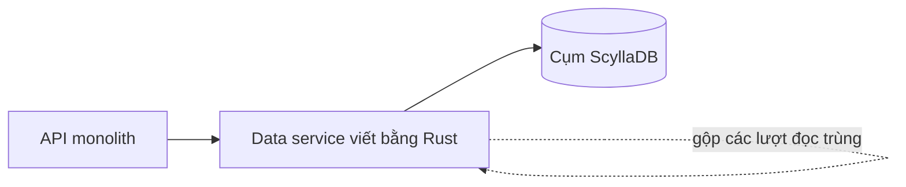

## Nơi câu chuyện bắt đầu

Discord lưu mọi tin nhắn trong một database nội bộ tên là cassandra-messages [S1 §Our Cassandra Troubles]. Đọc thành yêu cầu, nghĩa là như sau. Về chức năng: ghi tin nhắn mới, và đọc lại lịch sử một kênh thật nhanh khi ai đó cuộn lên. Về phi chức năng: không downtime, độ trễ dự đoán được, và khối lượng vận hành không tăng theo dữ liệu.

Năm 2017 cụm này có 12 node Cassandra [S1 §Our Cassandra Troubles]. Đầu năm 2022 nó có 177 node và lưu hàng nghìn tỷ tin nhắn [S1 §Our Cassandra Troubles]. Đó là thang đo của bài toán: số máy tăng nhiều lần, và toil tăng theo. Bài blog gọi nó là một hệ thống nhiều toil: on-call bị page thường xuyên vì database, độ trễ khó đoán, và đội phải cắt bớt các thao tác bảo trì vì chúng đắt đến mức không dám chạy [S1 §Our Cassandra Troubles].

Đọc thành mục tiêu, đội không muốn "nhanh hơn" nói chung. Họ muốn một cụm mà chi phí vận hành thôi tăng cùng tốc độ với dữ liệu. Mục tiêu đó giải thích vì sao họ làm hai việc chứ không chỉ một.

## Cái gì làm cụm Cassandra mệt

Để hiểu vấn đề, cần nhìn cách tin nhắn được lưu. Discord partition tin nhắn theo kênh, cộng thêm một bucket là một khung thời gian cố định, nên mọi tin nhắn của một kênh trong một bucket nằm cùng nhau và được replicate sang ba node [S1 §Our Cassandra Troubles]. Cách chia này có một cái bẫy được chính bài blog chỉ ra: một server vài người bạn gửi ít tin hơn nhiều bậc so với một server hàng trăm nghìn người [S1 §Our Cassandra Troubles].

Nút thắt đầu tiên là hot partition. Trong Cassandra, đọc đắt hơn ghi, vì ghi chỉ nối vào commit log và memtable, còn đọc phải xem memtable và có thể nhiều SSTable trên đĩa [S1 §Our Cassandra Troubles]. Khi rất nhiều người đọc cùng lúc một kênh, một cặp channel và bucket nhận lượng traffic lớn, node phục vụ nó cố gắng hết sức, tụt lại ngày càng xa, và các query khác trên node đó cũng chậm theo. Vì đội đọc và ghi ở mức quorum, mọi query chạm vào các node giữ partition nóng đều chịu độ trễ cao hơn, và người dùng cảm nhận được [S1 §Our Cassandra Troubles]. Thêm node không sửa được chuyện này, vì dữ liệu nóng vẫn nằm trên cùng vài node.

Nút thắt thứ hai là bảo trì. Cụm hay bị tụt lại trong compaction, nghĩa là đọc đắt hơn và độ trễ lan thành dây chuyền khi một node cố compact [S1 §Our Cassandra Troubles]. Đội có hẳn một thao tác tên là "gossip dance": đưa node ra khỏi rotation để nó compact mà không nhận traffic, đưa lại để nhận hint từ hinted handoff, rồi lặp cho đến khi hết backlog [S1 §Our Cassandra Troubles]. Thêm vào đó là việc tinh chỉnh garbage collector và heap của JVM, vì GC pause gây ra các đỉnh độ trễ. Có những lần pause liên tiếp kéo dài đến mức một operator phải tự tay reboot và trông node đó cho tới khi nó khỏe lại [S1 §Changing Our Architecture].

Nhìn từ bên ngoài, p99 khi đọc tin nhắn cũ dao động giữa 40 và 125 ms, còn p99 khi insert dao động giữa 5 và 70 ms [S1 §Several Months Later…]. Khoảng rộng như vậy nghĩa là những lượt đọc kém may mắn rất khó đoán. Đằng sau các con số đó, đội on-call bị page thường xuyên vì database [S1 §Our Cassandra Troubles].

## Hai thay đổi, và vì sao không chỉ một

ScyllaDB nằm trong tầm ngắm của đội từ trước. Nó nói cùng giao thức với Cassandra, viết bằng C++ và không có garbage collector, đúng phần họ quan tâm nhất [S1 §Changing Our Architecture]. Sau khi thử nghiệm thấy cải thiện, họ quyết định chuyển mọi database, và đến năm 2020 chỉ còn cassandra-messages ở lại Cassandra [S1 §Changing Our Architecture].

Lý do chưa chuyển nó cũng rõ: cụm quá lớn, cộng thêm việc họ muốn có kinh nghiệm chạy ScyllaDB trên production trước. Đội còn phát hiện reverse query của ScyllaDB chưa đủ nhanh cho nhu cầu của mình, và đội ScyllaDB đã ưu tiên cải thiện phần đó [S1 §Changing Our Architecture]. Đây là một cái giá đáng nhớ: chọn database mới nghĩa là bạn có thể phải chờ nhà cung cấp sửa thứ bạn cần.

Quan trọng hơn, họ không kỳ vọng một database mới tự sửa được mọi thứ. ScyllaDB cũng có thể gặp hot partition, nên họ dựng lớp bảo vệ ở upstream [S1 §Changing Our Architecture]. Lớp đó là data service, một tầng Rust nằm giữa API monolith và các cụm database. Nó mỏng có chủ đích: khoảng một gRPC endpoint cho mỗi query và không có business logic [S1 §Data Services Serving Data].

Tính năng chính của chúng là request coalescing. Nếu nhiều người đọc cùng một hàng cùng lúc, service chỉ query database một lần: người đầu tiên làm một worker task được tạo ra, các request sau đó tìm task ấy và đăng ký nhận kết quả, rồi task trả hàng cho tất cả [S1 §Data Services Serving Data]. Một thông báo @everyone trên server lớn khi đó không còn biến thành vô số lượt đọc giống hệt nhau đập vào một partition. Để coalescing hiệu quả, request còn được route bằng consistent hashing: với tin nhắn, routing key là channel ID, nên mọi request của cùng một kênh đến cùng một instance [S1 §Data Services Serving Data].

Cái giá của thiết kế này là thêm một service phải vận hành, và một điểm trung gian mọi request đều đi qua. Đổi lại, tải đến partition nóng không còn tỷ lệ với số người tò mò. Chính bài blog cũng thừa nhận phần này chưa giải quyết hết: họ vẫn thấy hot partition và độ trễ tăng trên cụm Cassandra, chỉ ít thường xuyên hơn, và các cải tiến này mua thời gian để chuẩn bị cụm ScyllaDB và thực hiện migrate [S1 §Data Services Serving Data].

## Migrate: ước tính ba tháng, còn chín ngày

Yêu cầu migrate khá thẳng: chuyển hàng nghìn tỷ tin nhắn mà không downtime, và phải nhanh, vì Cassandra vẫn đang khiến đội phải chữa cháy [S1 §A Very Big Migration]. Kế hoạch đầu tiên được thiết kế để có giá trị sớm: dùng cụm ScyllaDB mới cho dữ liệu mới theo một mốc thời gian, rồi chuyển dữ liệu lịch sử theo sau. Chính họ thừa nhận cách này thêm độ phức tạp [S1 §A Very Big Migration].

Họ bắt đầu dual-write dữ liệu mới vào cả Cassandra và ScyllaDB, đồng thời dựng Spark migrator của ScyllaDB. Công cụ này cần tinh chỉnh nhiều, và khi chạy được thì ước tính hoàn thành là ba tháng [S1 §A Very Big Migration]. Ba tháng là quá dài với một đội đang chữa cháy hằng tuần, và cũng là quá dài để mang rủi ro của hai hệ thống phải luôn khớp nhau.

Rồi có người nhớ ra đội đã có sẵn một thư viện database nhanh cho data service. Họ mở rộng nó thành một migrator đọc các token range, lưu tiến độ bằng checkpoint SQLite cục bộ và ghi thẳng vào ScyllaDB [S1 §A Very Big Migration]. Việc này mất một buổi chiều. Ước tính mới là chín ngày, đủ nhanh để họ bỏ kế hoạch theo mốc thời gian và chuyển mọi thứ một lần [S1 §A Very Big Migration]. Ở đỉnh, nó copy tới 3,2 triệu hàng mỗi giây [S1 §A Very Big Migration].

Lỗi đáng giữ lại: việc migrate kẹt ngay trước khi hoàn tất. Các token range cuối chứa tombstone tích tụ nhiều năm chưa được compact trên Cassandra, nên lượt đọc của migrator bị timeout cho đến khi đội compact chúng, sau đó nó xong trong vài giây [S1 §A Very Big Migration]. Nợ bảo trì bạn lờ đi nhiều năm sẽ đến hạn đúng vào đoạn cuối.

Để kiểm chứng, đội tự động gửi một tỷ lệ nhỏ lượt đọc tới cả hai database và so sánh kết quả. Cụm mới chịu được toàn bộ traffic production trong khi Cassandra ngày càng hay gặp vấn đề về độ trễ. Rồi họ chuyển ScyllaDB thành database chính [S1 §A Very Big Migration].

## Sau cutover, và những gì con số chưa chứng minh

Đội chuyển database tin nhắn sang ScyllaDB vào tháng 5 năm 2022 [S1 §Several Months Later…]. Từ đó bài blog báo cáo một database yên lặng, không còn những cuộc chữa cháy kéo dài cả cuối tuần và không còn phải xoay node để giữ uptime. Cụm đi từ 177 node Cassandra xuống 72 node ScyllaDB [S1 §Several Months Later…]. P99 khi lấy tin nhắn cũ đi từ 40–125 ms xuống 15 ms, và p99 khi insert đi từ 5–70 ms xuống mức ổn định 5 ms [S1 §Several Months Later…]. Cả hai cải thiện nằm ở phần đuôi, không phải trung bình: dự án làm những lượt đọc tệ bớt tệ.

Đây là bài kể của chính những người đã làm, nên hãy đọc nó đúng như vậy. Các con số cho thấy tổ hợp ScyllaDB, data service và một migrator nhanh đã hiệu quả với workload này. Chúng không chứng minh ScyllaDB nhanh hơn Cassandra nói chung. Bài viết cũng không tách riêng phần cải thiện nào đến từ database và phần nào đến từ coalescing. Hãy coi đây là một case, không phải một benchmark.

Và một điều nữa dễ bị bỏ sót: bài blog vẫn nói thẳng rằng ScyllaDB "most definitely not void of issues" [S1 §Changing Our Architecture]. Phần thắng của Discord không nằm ở chỗ tìm được một database hoàn hảo, mà ở chỗ họ chọn một database có kiểu hỏng mà đội hiểu, rồi dựng lớp bảo vệ ở phía trước nó.
