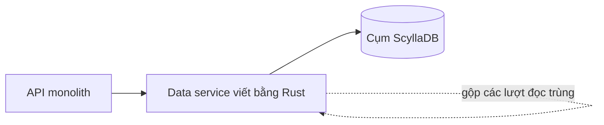

## Nơi câu chuyện bắt đầu

Đầu năm 2022, có một database ở Discord khiến kỹ sư mất ngủ. Một số việc bảo trì định kỳ đã bị bỏ vì đội không còn kham nổi chi phí chạy chúng, độ trễ lên xuống không báo trước, và on-call bị page thường xuyên vì nó [S1 §Our Cassandra Troubles]. Database đó đã phình lên 177 node Cassandra, chứa hàng nghìn tỷ tin nhắn [S1 §Our Cassandra Troubles]. Hồi 2017, cùng khối việc ấy chỉ cần 12 node [S1 §Our Cassandra Troubles].

Mọi tin nhắn gửi trên Discord đều về đây; nội bộ gọi nó là cassandra-messages [S1 §Our Cassandra Troubles].

Viết thành brief cho buổi design review thì yêu cầu khá ngắn. Hệ thống phải nhận tin nhắn mới, và trả lịch sử một kênh thật nhanh khi ai đó cuộn ngược lên. Bao quanh đó là các yêu cầu vận hành: không downtime, độ trễ dự đoán được, và chi phí vận hành không tăng cùng nhịp với dữ liệu.

Theo cách tôi đọc, yêu cầu cuối mới là mục tiêu thật, hơn cả tốc độ, và nó giải thích vì sao câu chuyện kết thúc với hai cách sửa chứ không phải một.

## Cái gì làm cụm Cassandra mệt

Bắt đầu từ mốc mà đội sau này dùng để so sánh. Trên Cassandra, p99 khi lấy tin nhắn cũ nằm đâu đó từ 40 đến 125 ms, còn p99 khi insert tin nhắn từ 5 đến 70 ms [S1 §Several Months Later…]. Với người dùng, biên độ rộng như vậy giống như ngẫu nhiên, và ngẫu nhiên khó chịu hơn chậm đều.

Biên độ ấy có hơn một nguyên nhân, và các nguyên nhân làm nhau tệ thêm.

Nguyên nhân đầu nằm ở chỗ dữ liệu được đặt ở đâu. Cassandra lưu mỗi partition trên nhiều replica, và partition key của Discord là kênh cộng một bucket, tức một khung thời gian cố định [S1 §Our Cassandra Troubles]. Traffic giữa các kênh chênh nhau nhiều bậc, từ nhóm vài người bạn đến các cộng đồng công khai khổng lồ [S1 §Our Cassandra Troubles]. Một đám đông mở cùng một kênh nóng tạo ra lượt đọc. Mỗi lượt đọc như vậy có thể phải lục thêm nhiều SSTable trên đĩa ngoài memtable, nên đám đông tốn kém khi đọc hơn nhiều so với khi gửi, vì một tin nhắn mới chỉ là một lần nối vào commit log và một lần ghi vào memtable [S1 §Our Cassandra Troubles]. Toàn bộ chi phí đó dồn lên vài node đang giữ replica của partition nóng.

Thiệt hại không dừng trong kênh đó. Discord dùng quorum cho cả đọc lẫn ghi, nên người dùng ở các kênh vắng cũng phải chờ theo, mỗi khi quorum của họ có một trong các replica đang quá tải [S1 §Our Cassandra Troubles]. Đó là hot partition. Mua thêm node không pha loãng được nó, vì key nóng vẫn rơi vào đúng những replica ấy.

Nguyên nhân thứ hai là việc dọn dẹp không bao giờ có đủ chỗ. Cassandra cần thời gian để gộp SSTable (compaction), JVM cần thời gian để thu gom rác; trên cụm này, cả hai phải giành thời gian đó từ traffic người dùng. Compaction để đuổi kịp đẩy độ trễ lên quanh bất cứ node nào đang chạy nó, và mỗi SSTable còn chờ gộp là thêm một file mà lượt đọc phải kiểm tra [S1 §Our Cassandra Troubles]. GC pause tạo thêm các đỉnh độ trễ riêng. Tệ nhất, một node cần đến con người: restart thủ công rồi canh chừng cẩn thận, sau khi các GC pause của nó nối đuôi nhau quá lâu [S1 §Changing Our Architecture].

Cách xoay xở với compaction cho thấy việc này ngốn bao nhiêu công sức người. Đội gọi nó là "gossip dance", và về bản chất nó đổi năng lực phục vụ lấy thời gian compact. Kỹ sư đi vòng qua cụm, cho từng node một khoảng lặng để compact trong khi hinted handoff giữ lại các ghi mà nó bỏ lỡ, và chỉ dừng khi compaction đã đuổi kịp [S1 §Our Cassandra Troubles]. Không phần nào trong đó làm sản phẩm tốt lên. Nó chỉ giữ cụm đứng yên tại chỗ.

## Hai thay đổi, và vì sao không chỉ một

Một phần cách sửa phải nằm phía trên database, vì hot partition sinh ra từ access pattern và ScyllaDB cũng không miễn nhiễm với chúng [S1 §Changing Our Architecture].

Phần đó là một lớp data service viết bằng Rust. API monolith gọi chúng thay vì gọi thẳng database. Giao diện của chúng cố ý mỏng: mỗi endpoint gRPC ứng với gần như đúng một query database, và quy tắc nghiệp vụ được giữ hoàn toàn bên ngoài [S1 §Data Services Serving Data].

Lý do chúng tồn tại là request coalescing. Database chỉ trả lời một lần cho mỗi hàng, bất kể có bao nhiêu request giống hệt nhau đang chờ. Bên dưới là một worker task cho mỗi hàng đang được đọc, mọi request trùng lặp đều đậu lại trên task đó cho tới khi có kết quả [S1 §Data Services Serving Data]. Nhờ vậy, ping @everyone trên server khổng lồ chỉ còn là một lượt đọc, thay vì cơn lũ lượt đọc giống nhau vào một partition.

Request trùng chỉ gộp được nếu chúng rơi vào cùng một process. Vì thế request được chia giữa các instance bằng consistent hashing trên channel ID, nghĩa là một kênh luôn nói chuyện với đúng một instance [S1 §Data Services Serving Data].

Cái giá khá rõ: thêm một service phải deploy và phải trực page, và thêm một chặng trên mọi lượt đọc ghi. Discord không thổi phồng cái họ nhận lại. Lớp này chủ yếu đem về thời gian, đủ để dựng cụm ScyllaDB và lên kế hoạch chuyển, trong khi Cassandra vẫn có hot partition và độ trễ tăng vọt, chỉ thưa hơn [S1 §Data Services Serving Data].

Còn việc đổi database thì chủ yếu xoay quanh garbage collector. ScyllaDB nói cùng giao thức với Cassandra nhưng viết bằng C++, nên không có GC nào làm node khựng lại, và đó là đặc tính đội coi trọng [S1 §Changing Our Architecture]. Đến năm 2020, mọi database khác của Discord đã nằm trên ScyllaDB, sau khi thử nghiệm cho thấy cải thiện; chỉ còn cassandra-messages [S1 §Changing Our Architecture].

Cụm còn sót lại có một chướng ngại cụ thể. Các lượt quét tin nhắn của Discord có reverse query, tức đọc ngược thứ tự sắp xếp của bảng, và trong thử nghiệm ScyllaDB chạy chúng quá chậm cho tới khi đội phát triển ScyllaDB ưu tiên sửa [S1 §Changing Our Architecture]. Đội cũng muốn chạy ScyllaDB trên production lâu hơn trước khi đụng tới cụm lớn nhất, một cụm đủ lớn để bất kỳ cuộc chuyển nào cũng thành một dự án riêng [S1 §Changing Our Architecture]. Đó là cái giá ẩn của một database trẻ hơn: lịch của bạn có thể phụ thuộc vào lộ trình của người khác.

Hãy tách các cách sửa trong đầu. Đổi database gỡ một vấn đề runtime, tức GC pause. Data service gỡ một vấn đề access pattern, tức các lượt đọc giống nhau dồn vào một partition. Đội chỉ có một trong hai vấn đề thì chỉ nên chờ một trong hai phần cải thiện.

## Migrate: ước tính ba tháng, còn chín ngày

Viết lại công cụ copy đã biến ước tính ba tháng thành chín ngày [S1 §A Very Big Migration]. Nó cũng định hình lại cả kế hoạch.

Việc chữa cháy trên cụm Cassandra đã dịu bớt nhưng chưa dừng, và điều đó đặt ra luật chơi: làm nhanh, và không bao giờ để dịch vụ sập [S1 §A Very Big Migration]. Kế hoạch đầu chấp nhận phức tạp thêm, điều đội tự thừa nhận, để đổi lấy giá trị sớm. Dữ liệu mới hơn một mốc cutover chọn trước sẽ nằm trên ScyllaDB ngay, còn lịch sử cũ hơn được backfill sau [S1 §A Very Big Migration].

Ba tháng là con số mà chính Spark migrator của ScyllaDB dự báo cho phần backfill đó, và chỉ sau khi tinh chỉnh rất nhiều; trong lúc ấy dual-write giữ cho tin nhắn mới chảy vào cả hai cụm [S1 §A Very Big Migration]. Với một đội vẫn đang chữa cháy, đó là quãng quá dài để giữ hai database khớp nhau.

Migrator thay thế chỉ tốn một buổi chiều, vì thư viện của data service vốn đã là một database client nhanh [S1 §A Very Big Migration]. Các hàng đi từ Cassandra sang ScyllaDB theo từng token range, mỗi range xong được ghi lại vào một checkpoint SQLite cục bộ [S1 §A Very Big Migration]. Cách chia theo tuổi dữ liệu bị bỏ và mọi thứ được chuyển trong một lượt, vì một việc chín ngày không còn đáng để gánh thêm phức tạp [S1 §A Very Big Migration]. Throughput đạt đỉnh 3,2 triệu hàng mỗi giây [S1 §A Very Big Migration].

Bước cuối của đợt migrate không phải copy mà là compaction. Vài giây sau khi đội compact các token range cuối, việc chuyển hoàn tất; trước đó nó đứng ngay sát vạch đích, migrator bị timeout trên một đống deletion marker (tombstone) tồn đọng mà Cassandra chưa từng dọn [S1 §A Very Big Migration]. Hãy để ý mối nối với chuyện compaction ở trên. Nếu bạn đang bỏ qua bảo trì, migrate là lúc hóa đơn tới.

Tính đúng đắn được kiểm bằng so sánh: cả hai database cùng trả lời một mẫu nhỏ các lượt đọc, và câu trả lời phải khớp. Bằng chứng quyết định đến từ cả hai phía cùng lúc. Sự cố độ trễ trên Cassandra ngày càng thường xuyên, trong khi ScyllaDB gánh tải production mà không gặp chuyện đó, nên ScyllaDB được nâng lên làm database chính [S1 §A Very Big Migration].

## Sau cutover, và những gì con số chưa chứng minh

Ít máy hơn, đuôi gọn hơn. Khối việc từng cần 177 node Cassandra giờ chạy trên 72 node ScyllaDB [S1 §Several Months Later…]. Insert ổn định ở p99 5 ms, từ mức 5–70 ms, còn đọc tin nhắn cũ ở 15 ms, từ mức 40–125 ms [S1 §Several Months Later…]. ScyllaDB tiếp quản vai trò database tin nhắn vào tháng 5 năm 2022 [S1 §Several Months Later…].

Đội mở đầu bằng thay đổi về vận hành. Không còn ai phải dời node qua lại để giữ cụm sống, và cuối tuần được để yên; từ mà chính nguồn dùng cho kết quả là quiet (yên ắng) [S1 §Several Months Later…]. Cả hai cải thiện độ trễ đều nằm ở phần đuôi chứ không ở trung bình, khớp với mục tiêu từ đầu: ít request tệ hơn và ít đêm mất ngủ hơn, không phải median nhanh hơn.

Hãy đọc các con số này với chút thận trọng. Đây là lời kể của chính người trong cuộc: nó cho thấy tổ hợp ScyllaDB và data service có coalescing hiệu quả với workload này. Nó không cho thấy ScyllaDB thắng Cassandra nói chung, vì bài viết không tách phần cải thiện của database khỏi phần của coalescing. Trước khi bắt chước, hãy xác định mình có nguyên nhân nào, runtime hay access pattern.

Đặc tính đội nêu đích danh là không có garbage collector, và S1 cẩn thận không hứa hơn thế: ScyllaDB có những vấn đề riêng của nó [S1 §Changing Our Architecture]. Đó là quy tắc tốt hơn "chọn database nhanh hơn": hãy chọn cái có kiểu hỏng mà đội bạn hiểu, rồi đặt lớp bảo vệ phía trước nó.
