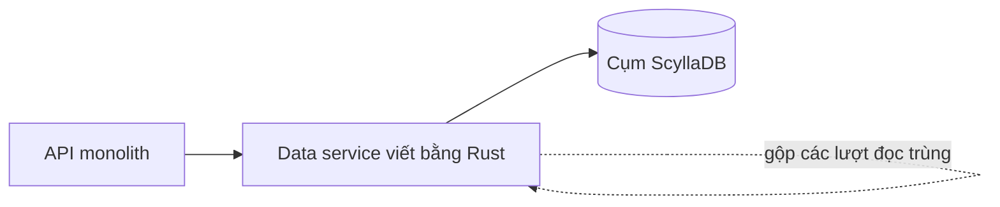

## Nơi câu chuyện bắt đầu

Discord lưu mọi tin nhắn trong một database nội bộ tên là cassandra-messages [S1 §Our Cassandra Troubles]. Đọc thành yêu cầu, nghĩa là như sau. Về chức năng: ghi tin nhắn mới, và đọc lại lịch sử một kênh thật nhanh khi ai đó cuộn lên. Về phi chức năng: không downtime, độ trễ dự đoán được, và khối lượng vận hành không tăng theo dữ liệu.

Năm 2017 cụm này có 12 node Cassandra [S1 §Our Cassandra Troubles]. Đến đầu năm 2022 nó có 177 node và chứa hàng nghìn tỷ tin nhắn [S1 §Our Cassandra Troubles]. Đó là thang đo của bài toán: số máy tăng nhiều lần, và công việc giữ chúng khỏe cũng tăng theo. On-call bị page thường xuyên, độ trễ thất thường, và một số việc bảo trì phải giảm bớt vì chạy chúng đã quá tốn kém [S1 §Our Cassandra Troubles].

Đọc thành mục tiêu, đội không muốn "nhanh hơn" nói chung. Họ muốn một cụm mà chi phí vận hành thôi tăng cùng tốc độ với dữ liệu. Mục tiêu đó giải thích vì sao họ làm hai việc chứ không chỉ một.

## Cái gì làm cụm Cassandra mệt

Tin nhắn được khóa theo kênh cộng một bucket, tức một lát thời gian cố định, nên mọi thứ của một kênh trong một bucket nằm cùng nhau trên ba replica [S1 §Our Cassandra Troubles]. Điểm vướng là độ chênh giữa các kênh: server của vài người bạn tạo ra lượng traffic nhỏ hơn nhiều bậc so với server có hàng trăm nghìn thành viên [S1 §Our Cassandra Troubles].

Nút thắt đầu tiên là hot partition. Trong Cassandra một lượt đọc tốn hơn một lượt ghi: ghi chỉ được nối vào commit log và một bảng trong bộ nhớ, còn đọc có thể cần bảng đó cùng vài file trên đĩa [S1 §Our Cassandra Troubles]. Khi một đám đông cùng đọc một kênh, một partition ôm hết tải, node của nó tụt lại, và các query khác trên node đó cũng chậm theo. Đọc và ghi đều đi qua quorum, nên mọi query cần một replica của partition đó đều chậm hơn, và người dùng nhận ra [S1 §Our Cassandra Troubles]. Thêm node không giúp, vì dữ liệu nóng vẫn nằm trên vài máy cũ.

Nút thắt thứ hai là bảo trì. Compaction thường xuyên bị trễ, làm đọc đắt hơn và để độ trễ lan dây chuyền khi node cố bắt kịp [S1 §Our Cassandra Troubles]. Cách xử lý là một chu trình thủ công đội gọi đùa là "gossip dance": đưa node ra khỏi rotation để nó compact mà không phục vụ traffic, đưa lại để nó nhận các ghi bị lỡ, rồi lặp đến khi hết backlog [S1 §Our Cassandra Troubles]. Tinh chỉnh JVM tốn thêm nhiều thời gian, vì GC pause tạo ra các đỉnh độ trễ, và có những pause nối đuôi nhau đến mức operator phải tự restart node rồi chăm nó hồi phục [S1 §Changing Our Architecture].

Nhìn từ bên ngoài, p99 khi đọc tin nhắn cũ dao động giữa 40 và 125 ms, còn p99 khi insert dao động giữa 5 và 70 ms [S1 §Several Months Later…]. Khoảng rộng như vậy nghĩa là những lượt đọc kém may mắn rất khó đoán. Đằng sau các con số đó, đội on-call bị page thường xuyên vì database [S1 §Our Cassandra Troubles].

## Hai thay đổi, và vì sao không chỉ một

ScyllaDB nằm trong tầm ngắm của đội từ trước. Nó nói cùng giao thức với Cassandra, viết bằng C++ và không có garbage collector, đúng phần họ quan tâm nhất [S1 §Changing Our Architecture]. Sau khi thử nghiệm thấy cải thiện, họ quyết định chuyển mọi database, và đến năm 2020 chỉ còn cassandra-messages ở lại Cassandra [S1 §Changing Our Architecture].

Họ chưa đụng đến cụm cuối cùng này vì những lý do dễ hiểu: kích thước của nó, và mong muốn có thêm kinh nghiệm chạy ScyllaDB trên production. Thử nghiệm còn cho thấy reverse query, tức quét ngược thứ tự sắp xếp của bảng, quá chậm với nhu cầu của họ, và các developer của ScyllaDB đã ưu tiên sửa phần đó [S1 §Changing Our Architecture]. Có một cái giá ẩn ở đây: database trẻ hơn có thể khiến bạn phải chờ lộ trình của người khác.

Quan trọng hơn, họ không kỳ vọng một database mới tự sửa được mọi thứ. ScyllaDB cũng có thể gặp hot partition, nên họ dựng lớp bảo vệ ở upstream [S1 §Changing Our Architecture]. Lớp đó là data service, một tầng Rust nằm giữa API monolith và các cụm database. Nó mỏng có chủ đích: khoảng một gRPC endpoint cho mỗi query và không có business logic [S1 §Data Services Serving Data].

Việc chính của service là request coalescing. Khi nhiều người cùng hỏi một hàng, chỉ một query đi xuống database: request đầu tiên khởi tạo một worker task, các request sau gắn vào task đó, và kết quả được chuyển cho tất cả [S1 §Data Services Serving Data]. Một lời ping @everyone trên server khổng lồ nhờ vậy không còn là đống lượt đọc giống hệt nhau trên một partition. Routing giúp việc này hiệu quả: request được hash tới một instance bằng routing key, với tin nhắn là channel ID, nên một kênh luôn rơi vào cùng một instance [S1 §Data Services Serving Data].

Cái giá của thiết kế này là thêm một service phải vận hành, và một điểm trung gian mọi request đều đi qua. Đổi lại, tải đến partition nóng không còn tỷ lệ với số người tò mò. Chính bài blog cũng thừa nhận phần này chưa giải quyết hết: họ vẫn thấy hot partition và độ trễ tăng trên cụm Cassandra, chỉ ít thường xuyên hơn, và các cải tiến này mua thời gian để chuẩn bị cụm ScyllaDB và thực hiện migrate [S1 §Data Services Serving Data].

## Migrate: ước tính ba tháng, còn chín ngày

Ràng buộc rất đơn giản: chuyển hàng nghìn tỷ tin nhắn mà không downtime, và xong sớm, vì cụm Cassandra vẫn đòi hỏi chữa cháy liên tục [S1 §A Very Big Migration]. Kế hoạch đầu nhắm tới việc có lợi ích sớm: phục vụ dữ liệu mới từ ScyllaDB sau một mốc thời gian rồi backfill lịch sử sau. Đội thừa nhận cách này phức tạp hơn [S1 §A Very Big Migration].

Ghi mới đi vào cả hai database trong lúc đội dựng Spark migrator do ScyllaDB cung cấp. Sau nhiều tinh chỉnh, nó dự báo ba tháng mới xong [S1 §A Very Big Migration]. Với một đội đang chữa cháy thì đó là một khoảng chờ dài, và cũng là rất lâu để giữ hai hệ thống luôn khớp nhau.

Rồi có người nhớ ra đội đã có sẵn một thư viện database nhanh cho data service. Họ mở rộng nó thành một migrator đọc các token range, lưu tiến độ bằng checkpoint SQLite cục bộ và ghi thẳng vào ScyllaDB [S1 §A Very Big Migration]. Việc này mất một buổi chiều. Ước tính mới là chín ngày, đủ nhanh để họ bỏ kế hoạch theo mốc thời gian và chuyển mọi thứ một lần [S1 §A Very Big Migration]. Ở đỉnh, nó copy tới 3,2 triệu hàng mỗi giây [S1 §A Very Big Migration].

Lỗi đáng giữ lại: việc migrate kẹt ngay trước khi hoàn tất. Các token range cuối chứa tombstone tích tụ nhiều năm chưa được compact trên Cassandra, nên lượt đọc của migrator bị timeout cho đến khi đội compact chúng, sau đó nó xong trong vài giây [S1 §A Very Big Migration]. Nợ bảo trì bạn lờ đi nhiều năm sẽ đến hạn đúng vào đoạn cuối.

Để kiểm tra tính đúng, đội sao một tỷ lệ nhỏ lượt đọc sang cả hai database và so kết quả. Cụm mới chịu được toàn bộ traffic production trong khi vấn đề độ trễ của Cassandra ngày càng thường xuyên, nên họ nâng ScyllaDB lên làm database chính [S1 §A Very Big Migration].

## Sau cutover, và những gì con số chưa chứng minh

Đội chuyển database tin nhắn sang ScyllaDB vào tháng 5 năm 2022 [S1 §Several Months Later…]. Từ đó bài blog báo cáo một database yên lặng, không còn những cuộc chữa cháy kéo dài cả cuối tuần và không còn phải xoay node để giữ uptime. Cụm đi từ 177 node Cassandra xuống 72 node ScyllaDB [S1 §Several Months Later…]. P99 khi lấy tin nhắn cũ đi từ 40–125 ms xuống 15 ms, và p99 khi insert đi từ 5–70 ms xuống mức ổn định 5 ms [S1 §Several Months Later…]. Cả hai cải thiện nằm ở phần đuôi, không phải trung bình: dự án làm những lượt đọc tệ bớt tệ.

Đây là bài kể của chính những người đã làm, nên hãy đọc nó đúng như vậy. Các con số cho thấy tổ hợp ScyllaDB, data service và một migrator nhanh đã hiệu quả với workload này. Chúng không chứng minh ScyllaDB nhanh hơn Cassandra nói chung. Bài viết cũng không tách riêng phần cải thiện nào đến từ database và phần nào đến từ coalescing. Hãy coi đây là một case, không phải một benchmark.

Một điểm nữa dễ bị bỏ sót: bài viết không khẳng định ScyllaDB hết rắc rối, chỉ nói nó không có garbage collector [S1 §Changing Our Architecture]. Phần thắng của Discord không nằm ở chỗ tìm được một database hoàn hảo, mà ở chỗ họ chọn một database có kiểu hỏng mà đội hiểu, rồi dựng lớp bảo vệ ở phía trước nó.
