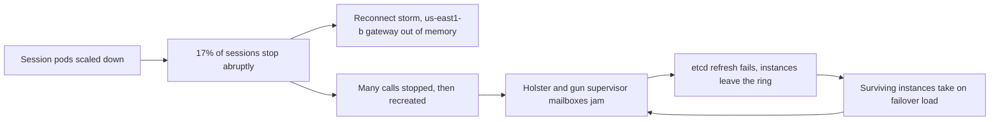

## A small change, three hops of damage

On the afternoon of 25 March 2026, Discord users who opened a voice chat saw "Awaiting Endpoint" and nothing else. From 12:13 to 15:30 PDT, most of them could neither start nor join a call [S1]. The interesting part is not that an outage happened but the path it took: it began in the session service, passed through the gateway, and ended by taking down a voice routing service several hops away, one that nobody deployed that day.

Written as a design-review brief, the functional requirement is simple. Users must be able to join calls, and every call has to be placed on an SFU (Selective Forwarding Unit, the box that relays media) close to its participants. The non-functional requirements are the hard part: the system has to absorb a large reconnect wave, and deploying a stateful service must never drop user state.

## Background: moving Elixir onto Kubernetes

The Realtime Infrastructure team was moving Discord's Elixir services onto Kubernetes [S1 §The Buildup]. These services hold state: each host keeps thousands of in-memory processes, each one standing for a guild (the internal name for a server), a presence or a call. Before a host goes away, every process on it must hand its data to another node. Deploys watch an entity counter on each machine and only stop the pod once that counter reaches zero [S1 §The Buildup].

The session service had just finished its move. Each connected device gets its own session process, and everything pushed to the client over the websocket, from messages to presence, flows through it [S1 §The Buildup]. On weekends the cluster's CPU ran hotter than the team liked. The plan was to scale vertically: more CPU and memory per pod, proportionally fewer pods. The point was to learn whether scheduler overhead was a fixed cost per pod or grew with the number of sessions [S1 §The Buildup]. A sensible change, the kind every team ships.

## Hop one: 17% of sessions vanish

At 12:13 the PR reached the first zone. With fewer replicas, Kubernetes stopped half of that zone's pods [S1 §Dropping Sessions]. There was a backstop: on the stop signal, the service tries to hand its processes off. But a safety check that waits for in-flight events to finish held the handoff back so long that the termination grace period ran out before the handoff could begin [S1 §Dropping Sessions]. The session service is spread evenly over three zones, so half of one zone meant 17% of all Discord sessions, and they stopped ungracefully [S1 §Dropping Sessions].

One Elixir mechanism matters here. The important processes are GenServers, and each handles exactly one message at a time, taken in order from a queue called the mailbox. That single-threaded behaviour sidesteps a whole class of concurrency problems [S1 §Dropping Sessions]. Other processes can monitor a session; when it dies, every monitoring process receives a `:DOWN` message [S1 §Dropping Sessions]. One session closing lets your guilds know to stop sending you data. When 17% of sessions close at once, a burst of `:DOWN` messages pours through the realtime systems, one per session for every process monitoring it [S1 §Dropping Sessions].

## Hop two: the gateway runs out of memory

The gateway is where every websocket connection enters and leaves. Lost sessions are routine (flaky networks, failing cloud hardware, a train going into a tunnel), so the gateway has a recovery path: on a dead session it tells the client to reconnect, tries to resume the old session in the same zone, and starts a new one if the old one is gone [S1 §Reconnecting Users].

This time the recovery path ran for 17% of users simultaneously, and nearly all of them sat in zone us-east1-b [S1 §Reconnecting Users]. A start-session rate limit existed to apply backpressure in exactly this situation. But it was defined per host and had not been retuned after the migration. Kubernetes ran more pods than the old VM setup, so the total let through was larger than before [S1 §Reconnecting Users]. Memory on every gateway node in us-east1-b climbed and the nodes began running out [S1 §Reconnecting Users].

The gateway going down dropped the connections of everyone else in that zone, even though their sessions were alive. They reconnected to us-east1-c and us-east1-d. Those whose sessions survived were back at once; the rest started new sessions [S1 §Reconnecting Users]. At this point chat healed itself. Voice did not.

## Hop three: two supervisors and a mailbox that never drains

Every session in a call has a voice state. Voice states flow from the service that owns the call (such as `discord_guilds` or `discord_calls`) to voice syncers. That service decides where each call lives and keeps sending RPC commands to more than 25,000 SFU instances [S1 §Overloading Voice Syncers]. When the last participant leaves, the syncer sends a blocking stop RPC to the SFU before cleaning up its own state [S1 §Overloading Voice Syncers]. Mass disconnects mean many calls empty out and stop; when people come back, syncers must recreate the calls, which means a flood of outgoing HTTPS connections [S1 §Overloading Voice Syncers].

Every outgoing HTTPS connection from voice syncers goes through Holster, an internal library that pools connections from gun, an Erlang HTTP client. The incident showed that opening a new connection passes through two supervisors: one shared by every `Holster.Pool`, one shared by every gun connection [S1 §Overloading Voice Syncers]. Each supervisor is a single GenServer. When it spawns a child, it does a selective receive, scanning its mailbox for the child's ACK. Post-incident tests showed that a mailbox of about 100,000 messages adds about 1 ms to every spawn [S1 §Overloading Voice Syncers]. Once requests arrive faster than the supervisor can work, the mailbox only grows and never catches up.

The two jams fail differently. A stuck gun supervisor means new connections cannot open within their timeout. A stuck `Holster.Pool` supervisor is worse: even existing connections cannot be checked out of the pool before the original request times out [S1 §Overloading Voice Syncers].

Then comes the detail that turned degradation into collapse. The etcd connection, through which Elixir nodes register in the consistent hash ring, also goes through those same two supervisors. Each instance must refresh its registration periodically; when the refresh is stuck behind the queue, the instance drops out of etcd once its 60-second TTL expires [S1 §Overloading Voice Syncers]. From 12:13, mailboxes grew on all 15 voice syncers instances and RPCs to SFUs collapsed [S1 §Overloading Voice Syncers]. The team used Recon to snapshot processes sorted by mailbox length, and at the top sat the Holster pool's DynamicSupervisor [S1 §Overloading Voice Syncers].

The loop at the end of the diagram is the frightening part. Each entity in the ring has three owners: primary, secondary and tertiary [S1 §Overloading Voice Syncers]. Any instance still alive picks up the work of the ones that dropped out, and jams in turn.

## Fighting a thundering herd

One instance, 2-8, recovered on its own, drained its mailbox and re-registered; alone it carried a 3/15 share of global syncer traffic [S1 §Overloading Voice Syncers]. The rest needed people.

The first instinct was to save hosts one at a time so ongoing calls would survive. At 12:43 the team restarted the application on instance 2-13; at 12:47 they restarted only the pool supervisor on 2-1 [S1 §Hook, Line, & Syncer: Bringing Voice Back Online]. Both recovered briefly, then jammed again, because any host that came back healthy immediately inherited the failover share of the sick ones [S1 §Hook, Line, & Syncer: Bringing Voice Back Online].

At 13:05 the team switched tactics and restarted the whole cluster, reasoning that more healthy hosts at once would mean less failover load on each. The cost was recreating millions of active calls at the same moment. By 13:09 every node's mailbox was growing again [S1 §Hook, Line, & Syncer: Bringing Voice Back Online]. This is a real trade-off: single-host restarts protect ongoing calls but drown the restarted host; a full restart spreads the load evenly but creates its own cold-start thundering herd. Neither wins while incoming load is unbounded.

So the team worked two fronts in parallel: cut demand with syncer creation rate limits, and add supply by growing the cluster [S1 §Hook, Line, & Syncer: Bringing Voice Back Online]. Cutting demand turned out harder than expected. The syncer creation limits in the call-owning services were stale or unset. The one in guilds was nearly useless: it capped only each guild's coordinating syncer, while child syncers for every voice channel could still be created without limit [S1 §Hook, Line, & Syncer: Bringing Voice Back Online]. Adding supply was slow, because voice syncers still ran on GCP VMs defined in Terraform, configured by Salt, and added by hand as ring candidates in etcd [S1 §Hook, Line, & Syncer: Bringing Voice Back Online].

The rate limits were ready first. At 13:43, calls, streams and guilds had low limits in place and the cluster was restarted again. This time the jammed supervisor was consistently gun's, not the pool's, so instances could still use connections already in the pool, stayed registered in etcd and got RPCs through for part of their calls [S1 §Hook, Line, & Syncer: Bringing Voice Back Online]. That was enough to go back to rescuing hosts one by one. At 14:03 a restart of 2-3 succeeded fully. By 14:15, 4 of the 5 restarted hosts had recovered, and 15 new instances came online at once, doubling capacity and halving the syncers per host. At 14:26 the last jammed host was restarted and the 30-instance cluster was fully healthy [S1 §Hook, Line, & Syncer: Bringing Voice Back Online].

## What they changed

At the trigger, Discord added a validating admission webhook for Elixir workloads on Kubernetes: a scale-down is rejected until the pod has finished handing off its processes [S1 §Making Improvements]. The trade-off is plain: slower scale-downs in exchange for never stopping a pod that still holds state.

At the bottleneck, the `Holster.Pool` supervisor was replaced with a `PartitionSupervisor`, which spreads requests across several independent supervisors so connections can be created and checked out in parallel. The gun connection lifecycle moved into the pool itself, so the shared gun supervisor is no longer used [S1 §Making Improvements]. Upstream rate limits were retuned and can be forced through load-shedding tooling, and voice syncers gained their own limits on endpoint selection [S1 §Making Improvements]. The team also added metrics on the connection pools' mailboxes [S1 §Making Improvements]. Longer term, they want voice on Kubernetes so adding hosts is a single command, and the voice control plane scaled horizontally across regions [S1 §Making Improvements].

## How to read this case

The post closes with a frame worth keeping: at a capacity limit you have two levers, add supply or cut demand, and it pays to ask that question out loud both during the incident and in the postmortem [S1 §Guided by Constraints]. In earlier large-load incidents the bottleneck was usually ScyllaDB, and Discord had since added circuit breaking in its API to shed demand. This time the databases held, and the bottleneck moved to voice [S1 §Guided by Constraints]. A big enough load spike always finds the next weak point.

The narrower technical lesson is about the process model. A single-threaded process keeps code simple, but if it sits on a hot path that every connection crosses, it is a global queue. Discord says it watches the "hot loop" of its busiest processes closely [S1 §Guided by Constraints]. This case shows the cost when one such process slips through unnoticed, especially when it also carries the node's own health registration.
