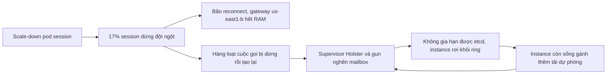

## Một thay đổi nhỏ, ba chặng thiệt hại

Chiều 25/3/2026, người dùng Discord mở voice chat và thấy mãi dòng "Awaiting Endpoint". Từ 12:13 đến 15:30 giờ PDT, phần lớn không bắt đầu hay vào được cuộc gọi [S1]. Điều đáng học là đường đi của sự cố: bắt đầu ở session service, qua gateway, rồi làm sập một service định tuyến voice cách đó vài chặng, service không hề được deploy hôm ấy.

Viết thành brief cho design review, yêu cầu chức năng khá đơn giản: người dùng vào được cuộc gọi, và mỗi cuộc gọi được đặt lên một SFU (Selective Forwarding Unit, máy trung chuyển media) gần người tham gia. Yêu cầu phi chức năng mới khó: chịu được một làn sóng reconnect lớn, và deploy service có state không được làm rơi state của người dùng.

## Bối cảnh: chuyển Elixir lên Kubernetes

Đội Realtime Infrastructure đang chuyển các service Elixir của Discord lên Kubernetes [S1 §The Buildup]. Các service này có state: mỗi host giữ hàng nghìn process trong bộ nhớ, mỗi process đại diện cho một guild (tên nội bộ của server), một trạng thái presence hay một cuộc gọi. Muốn tắt một host thì mọi process trên đó phải handoff dữ liệu sang node khác trước. Quy trình deploy canh một bộ đếm entity trên từng máy và chỉ tắt pod khi bộ đếm về 0 [S1 §The Buildup].

Session service vừa chuyển xong. Mỗi thiết bị đang kết nối có một session process riêng, và mọi thứ đẩy xuống client qua websocket đều đi qua nó [S1 §The Buildup]. Cuối tuần, CPU cụm này chạy nóng hơn mức đội muốn. Kế hoạch là scale dọc: tăng CPU và RAM mỗi pod, giảm số pod theo tỷ lệ, để xem overhead của scheduler cố định theo pod hay tăng theo số session [S1 §The Buildup]. Một thay đổi hợp lý, đội nào cũng từng làm.

## Chặng một: 17% session biến mất

Lúc 12:13, PR được áp cho zone đầu tiên. Số replica giảm, nên Kubernetes tắt một nửa số pod của zone đó [S1 §Dropping Sessions]. Service có cơ chế dự phòng: khi nhận tín hiệu tắt từ Kubernetes, nó cố handoff các process đi. Nhưng một bước kiểm tra an toàn, vốn chờ các sự kiện đang dở dang kết thúc, giữ handoff lại lâu tới mức termination grace period hết trước khi handoff kịp bắt đầu [S1 §Dropping Sessions]. Session service chạy cân bằng trên ba zone, nên một nửa của một zone là khoảng 17% tổng số session của Discord, và chúng bị dừng không graceful [S1 §Dropping Sessions].

Ở đây cần hiểu một cơ chế của Elixir. Các process quan trọng là GenServer, mỗi cái xử lý đúng một message tại một thời điểm, lấy lần lượt từ hàng đợi gọi là mailbox. Tính đơn luồng này giúp tránh cả loạt vấn đề concurrency [S1 §Dropping Sessions]. Process khác có thể monitor một session; khi session chết, mọi bên đang monitor nó đều nhận một message `:DOWN` [S1 §Dropping Sessions]. Một session tắt thì guild của bạn biết để ngừng gửi dữ liệu cho bạn. Khi 17% session tắt cùng lúc, hàng loạt message `:DOWN` đổ vào hệ thống realtime, mỗi session một message cho mỗi bên đang monitor nó [S1 §Dropping Sessions].

## Chặng hai: gateway hết RAM

Gateway là cửa vào và ra của mọi kết nối websocket. Session biến mất vốn là chuyện thường ngày (mạng chập chờn, phần cứng cloud lỗi, đi tàu qua hầm), nên gateway có sẵn đường phục hồi: thấy session chết thì bảo client reconnect, thử nối lại session cũ ở cùng zone, và nếu session không còn thì tạo session mới [S1 §Reconnecting Users].

Lần này đường phục hồi đó chạy cho 17% người dùng cùng một lúc, và hầu hết họ đều nằm ở zone us-east1-b [S1 §Reconnecting Users]. Có một rate limit cho việc tạo session để tạo backpressure đúng trong tình huống này. Nhưng limit đó tính theo từng host và chưa được tinh chỉnh lại sau migration. Kubernetes chạy nhiều pod hơn kiến trúc VM cũ, nên tổng lượng request được cho qua lớn hơn trước [S1 §Reconnecting Users]. RAM của mọi node gateway trong us-east1-b tăng vọt và các node bắt đầu hết bộ nhớ [S1 §Reconnecting Users].

Gateway sập kéo theo kết nối của những người dùng còn lại trong zone, dù session của họ vẫn sống. Họ reconnect sang us-east1-c và us-east1-d. Ai còn session thì vào lại ngay, ai mất thì bắt đầu tạo session mới [S1 §Reconnecting Users]. Tới đây, phần chat tự lành. Phần voice thì không.

## Chặng ba: hai supervisor và một mailbox không bao giờ cạn

Mỗi session đang ở trong cuộc gọi có một voice state. Voice state đi từ service sở hữu cuộc gọi (như `discord_guilds` hay `discord_calls`) tới voice syncers. Service này quyết định đặt mỗi cuộc gọi ở đâu và liên tục gửi lệnh RPC tới hơn 25.000 instance SFU [S1 §Overloading Voice Syncers]. Khi người cuối cùng rời cuộc gọi, syncer gửi một RPC stop có chờ phản hồi tới SFU rồi mới dọn state của mình [S1 §Overloading Voice Syncers]. Hàng loạt session rớt thì hàng loạt cuộc gọi trống và bị dừng; khi họ quay lại, syncers phải tạo lại cuộc gọi, tức là mở một cơn lũ kết nối HTTPS ra ngoài [S1 §Overloading Voice Syncers].

Mọi kết nối HTTPS đi ra của voice syncers dùng thư viện nội bộ Holster để pool kết nối của gun, một HTTP client viết bằng Erlang. Sự cố cho thấy để tạo kết nối mới, request phải đi qua hai supervisor: một cho mọi `Holster.Pool`, một cho mọi kết nối gun [S1 §Overloading Voice Syncers]. Mỗi supervisor là một GenServer duy nhất. Khi spawn process con, nó dùng selective receive, tức là lục trong mailbox để tìm đúng message ACK từ process con. Thử nghiệm sau sự cố cho thấy với mailbox khoảng 100.000 message, mỗi lần spawn chậm thêm khoảng 1 ms [S1 §Overloading Voice Syncers]. Khi yêu cầu mới tới nhanh hơn tốc độ supervisor xử lý, mailbox chỉ dài thêm và không bao giờ đuổi kịp.

Hai kiểu nghẽn cho hai kết quả khác nhau. Supervisor của gun nghẽn thì không mở được kết nối mới trong thời hạn timeout. Supervisor của `Holster.Pool` nghẽn thì tệ hơn: cả kết nối cũ cũng không lấy ra khỏi pool kịp trước khi request gốc hết hạn [S1 §Overloading Voice Syncers].

Rồi đến chi tiết làm mọi thứ sụp hẳn. Kết nối tới etcd, nơi các node Elixir đăng ký vào consistent hash ring, cũng đi qua đúng hai supervisor đó. Mỗi instance phải gia hạn đăng ký định kỳ; khi việc gia hạn bị kẹt sau hàng đợi, instance tự rơi khỏi etcd khi TTL 60 giây hết hạn [S1 §Overloading Voice Syncers]. Từ 12:13, mailbox trên cả 15 instance voice syncers cùng phình lên và số RPC tới SFU tụt mạnh [S1 §Overloading Voice Syncers]. Đội dùng Recon để chụp danh sách process sắp theo độ dài mailbox, và đứng đầu là DynamicSupervisor của pool Holster [S1 §Overloading Voice Syncers].

Vòng lặp cuối trong sơ đồ là phần đáng sợ nhất. Mỗi thực thể trong ring có ba instance phụ trách: chính, phụ và dự phòng thứ ba [S1 §Overloading Voice Syncers]. Instance nào còn sống sẽ nhận luôn phần việc của các instance đã rơi, và vì thế cũng nghẽn theo.

## Đánh nhau với thundering herd

Một instance, 2-8, tự hồi được, dọn sạch mailbox và đăng ký lại; một mình nó gánh 3/15 lượng syncer toàn cầu [S1 §Overloading Voice Syncers]. Phần còn lại cần người can thiệp.

Phản xạ đầu tiên là cứu từng máy để không làm rớt cuộc gọi đang chạy. Lúc 12:43, đội restart ứng dụng trên instance 2-13; lúc 12:47, họ restart riêng supervisor của pool trên 2-1 [S1 §Hook, Line, & Syncer: Bringing Voice Back Online]. Cả hai hồi lại được một chút rồi nghẽn lại, vì máy vừa khỏe đã phải nhận ngay phần dự phòng của các máy còn bệnh [S1 §Hook, Line, & Syncer: Bringing Voice Back Online].

Lúc 13:05, đội đổi hướng và restart cả cụm, với lập luận rằng càng nhiều máy khỏe cùng lúc thì càng ít phần dự phòng phải gánh. Cái giá là phải dựng lại hàng triệu cuộc gọi cùng lúc. Đến 13:09, mọi node lại có mailbox dài dần [S1 §Hook, Line, & Syncer: Bringing Voice Back Online]. Đây là đánh đổi thật: restart từng máy giữ được cuộc gọi đang chạy nhưng máy mới bị dìm ngay; restart cả cụm chia đều tải nhưng tự tạo ra một thundering herd lúc khởi động lạnh. Không cách nào thắng khi lượng tải đầu vào vẫn không bị chặn.

Vì vậy đội đánh trên hai mặt trận cùng lúc: giảm cầu bằng rate limit tạo syncer, và tăng cung bằng cách nới cụm [S1 §Hook, Line, & Syncer: Bringing Voice Back Online]. Giảm cầu khó hơn dự kiến: rate limit tạo syncer ở các service sở hữu cuộc gọi đã cũ hoặc chưa đặt, còn limit ở guilds chỉ giới hạn syncer điều phối của mỗi guild, còn syncer con cho từng kênh voice vẫn được tạo thoải mái [S1 §Hook, Line, & Syncer: Bringing Voice Back Online]. Tăng cung thì chậm, vì voice syncers vẫn chạy trên VM GCP khai báo bằng Terraform, cấu hình bằng Salt, và phải thêm tay vào danh sách ứng viên trong etcd [S1 §Hook, Line, & Syncer: Bringing Voice Back Online].

Rate limit xong trước. Lúc 13:43, calls, streams và guilds đã có limit thấp, và cụm được restart lần nữa. Lần này supervisor bị nghẽn luôn là của gun chứ không phải của pool, nên các instance vẫn dùng được kết nối đã có trong pool, giữ được đăng ký trong etcd và gửi RPC thành công cho một phần cuộc gọi [S1 §Hook, Line, & Syncer: Bringing Voice Back Online]. Đủ để quay lại cứu từng máy. Lúc 14:03, restart 2-3 thành công hẳn. Đến 14:15, 4 trên 5 máy được restart đã hồi phục, và 15 instance mới lên mạng cùng lúc, nhân đôi năng lực và chia đôi số syncer trên mỗi máy. Lúc 14:26, máy nghẽn cuối cùng được restart và cụm 30 instance khỏe hoàn toàn [S1 §Hook, Line, & Syncer: Bringing Voice Back Online].

## Họ sửa gì

Ở gốc sự cố, Discord thêm một validating admission webhook cho workload Elixir: lệnh scale-down bị từ chối cho đến khi pod handoff xong [S1 §Making Improvements]. Đánh đổi ở đây rõ ràng: scale-down chậm hơn, đổi lại không bao giờ tắt một pod còn giữ state.

Ở nút thắt, supervisor của `Holster.Pool` được thay bằng `PartitionSupervisor`, chia request ra nhiều supervisor độc lập để tạo và lấy kết nối song song. Vòng đời kết nối gun được chuyển hẳn vào pool, nên supervisor chung của gun không còn được dùng nữa [S1 §Making Improvements]. Rate limit phía gọi vào được chỉnh lại, có thể ép áp dụng qua công cụ load shedding, và voice syncers có thêm limit riêng cho việc chọn endpoint [S1 §Making Improvements]. Đội cũng thêm metric cho mailbox của pool kết nối [S1 §Making Improvements]. Về lâu dài, họ muốn đưa voice lên Kubernetes để thêm máy chỉ còn là một lệnh, và scale ngang control plane của voice qua nhiều region [S1 §Making Improvements].

## Đọc case này thế nào

Bài viết kết thúc bằng một khung tư duy đáng mang theo: khi gặp giới hạn năng lực, bạn chỉ có hai đòn bẩy, tăng cung hoặc giảm cầu, và nên hỏi thẳng câu đó cả lúc xử lý sự cố lẫn lúc viết postmortem [S1 §Guided by Constraints]. Trong các sự cố tải lớn trước đây, nút thắt thường là ScyllaDB, và Discord đã thêm circuit breaking ở API để cắt bớt nhu cầu. Lần này database ổn, và nút thắt chuyển sang voice [S1 §Guided by Constraints]. Một đợt tải đủ lớn luôn tìm ra chỗ yếu tiếp theo.

Bài học kỹ thuật hẹp hơn nằm ở mô hình process. Process đơn luồng giúp code đơn giản, nhưng nếu mọi kết nối đều phải đi qua nó thì nó là một hàng đợi toàn cục. Discord nói họ luôn để ý "hot loop" của các process bận nhất [S1 §Guided by Constraints]. Case này cho thấy cái giá khi một process như vậy lọt lưới, nhất là khi nó gánh cả việc đăng ký của chính node.
