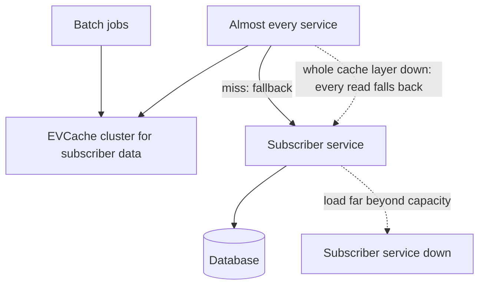

## Ten good services make one worse product

Picture ten services, each available 99.99% of the time, which still allows about 53 minutes of downtime a year for each of them [S1 @17:50]. Put all ten on the path of a request, and their bad minutes stack. The product as a whole comes out near three nines, somewhere between eight and nine hours of downtime a year [S1 @18:08]. Every part is excellent, and the total is far worse than any of them.

Josh Evans used this thought experiment in his talk on how Netflix runs microservices [S1 @17:48]. He had spent the previous three years leading operations engineering, the group behind chaos engineering, monitoring and delivery tooling at Netflix [S1 @04:10]. The arithmetic is the frame for everything else in the talk, so it is worth fixing in mind before the mechanisms.

The scale behind it: about 86 million members [S1 @05:09], about 190 countries [S1 @05:14], thousands of device platforms, every one of them backed by microservices on AWS [S1 @05:21].

As a design-review brief, the functional requirement is short. A member opens the app, finds something to watch, even if it is only a list of popular titles, and presses play [S1 @18:32]. The non-functional requirements are harder. That path must keep working when any one service fails, when a bad deploy goes out, and when a whole AWS region goes away, a target Netflix set after the 2012 ELB control-plane failure in us-east-1 left it nowhere to go [S1 @24:13] [S1 @24:31]. It must also hold up while teams keep shipping, because changes are when things break; the talk shows outages peaking around 9 a.m., when engineers start pushing code [S1 @43:49].

Netflix did not start here. In 2000 [S1 @05:41] it ran one Java application against one large Oracle database, and when that database failed, everything failed with it [S1 @07:04]. Microservices were the reaction: separate concerns, scale horizontally, split the work into pieces small enough to manage [S1 @08:58]. The availability math is the bill for that choice. Every hop to another box is a new way to fail: network latency or congestion, broken hardware, a dependency that just shipped a bug or was never scaled for this load [S1 @14:40].

So the bottleneck in this case is not CPU or storage. It is dependency: how many other services one request quietly relies on, and what happens when one of them goes quiet.

## Defending each call, then testing only the list that matters

Without defences, a single failing service can cascade into an outage for every member. If the faulty change has already reached every region, there is nowhere to fail over to, and the fix has to happen in place [S1 @15:07].

Netflix's answer at the level of one call was Hystrix [S1 @15:34]. It gives each call a structured timeout and retry policy. It adds a fallback, such as a static response, so the member can carry on rather than hit an error. It runs calls in isolated thread pools, so one slow dependency cannot use up every thread in the caller. And it adds a circuit breaker: when calls to a dependency keep failing, stop making them, return the fallback at once, and give the dependency room to recover [S1 @15:54].

A configuration is a claim, not evidence. To learn whether the settings hold at real scale, Netflix built FIT, a fault injection test framework that runs in production [S1 @16:42]. FIT can fail requests for synthetic transactions tied to a test account or device, or, once those pass, for a share of live traffic [S1 @16:47]. Requests carry context, so the injected failure applies however the target is reached, directly or several hops away. The service behaves as if it were down without anyone taking it down [S1 @17:05].

Testing call by call runs out quickly, though. With 100 microservices that each depend on several others, the combinations to check run into the millions [S1 @17:28]. And the availability arithmetic says the same thing from another side: every service in the playback path costs nines.

Netflix's way out was to draw a line. Critical services are the few needed for the basic experience: open the app, browse, start playback [S1 @18:25]. Everything else is optional by definition. FIT recipes then blacklist every non-critical service at once, and Netflix has run those recipes in production for short windows to confirm that members can still watch with all of them gone [S1 @18:44]. Evans describes this as far simpler than testing pairs of services, and says it has found critical errors [S1 @19:07].

The trade-off has two real sides. In favour: one test covers the scenario that matters most, and every team off the list gets a clear contract, which is that its outage must never stop playback. Against: every non-critical service now needs a fallback that actually works, and each production run of the recipe is a deliberate, if brief, bet with real traffic.

## When losing a node is an event

For stateless services, Netflix wanted a dead instance to be a non-event. Autoscaling replaces bad nodes and absorbs traffic spikes [S1 @26:32], and Chaos Monkey, the first of its chaos tools, keeps proving that killing an instance changes nothing [S1 @27:21]. Evans says losing a single node no longer took the service down after Chaos Monkey arrived [S1 @27:30].

Stateful services are the opposite case. Losing a node of a database or cache is a serious matter, and bringing up a replacement can take hours [S1 @28:20]. Evans adds that a service tier which mixed business logic with large in-memory state was the hardest thing to replicate once Netflix spread across regions, and he advises keeping the two apart [S1 @28:01].

The cache story from the early cloud years shows how bad it can get. Engineers from Yahoo brought a design they knew: customers were pinned to dedicated cache nodes, and each customer's data lived on exactly one of them [S1 @28:43]. Hystrix-style isolation was not yet in place: no bulkheads, no separate thread pools [S1 @29:05]. So when one node failed, all of Netflix failed with it, and recovery took about three and a half hours, including the wait for the cache to refill [S1 @29:13].

Notice that two weaknesses lined up. Data with a single copy made one node matter. Callers without isolation made one node matter to everyone. With isolation in place, a single-copy node would have cut off only its own customers [S1 @28:57].

The replacement was EVCache, a wrapper around memcached [S1 @29:51]. It is still sharded, but each write lands on several nodes in different availability zones. Reads stay in the local zone for speed, and the client can read from another zone when the local copy is unavailable [S1 @30:03]. By the time of the talk, practically every Netflix service that needed a cache used it [S1 @30:28]. The talk does not price this, but the cost is easy to see: several copies of every object, and more writes for each update.

## When the cache quietly became the dependency

EVCache works well enough to be taken for granted [S1 @30:46]. It handles about 30 million requests per second across Netflix's clusters worldwide, roughly 2 trillion a day, holding hundreds of billions of objects on tens of thousands of memcached instances [S1 @30:52]. With enough nodes, responses stay in the milliseconds as load grows [S1 @31:10].

That success hid a dependency. The subscriber service, which answers questions about a member, is something nearly every other service calls [S1 @31:30]. Its EVCache cluster served both batch jobs, such as recommendation runs, and the real-time request path [S1 @31:40]. Inside a single request, the same application might read it several times, as if each read were free [S1 @31:54]. At peak, that pattern meant 800,000 to a million requests per second against the subscriber tier [S1 @32:05].

Taken one miss at a time, the fallback was reasonable: no cached value, so read from the source. The trouble came when the same rule applied while the entire cache layer was unavailable, sending the service and its database a load that only EVCache had ever been able to carry [S1 @32:19]. The right move in that situation is to fail fast [S1 @32:32]. Instead, under the excess load EVCache went down and took the whole subscriber service down with it [S1 @32:36].

The fixes go into the callers. Keep batch work away from the systems that serve live requests. Request-scoped caching means repeat reads inside one request reuse the first result [S1 @32:44]. And, as a plan Netflix had not yet built, give devices an encrypted token carrying enough about the member to keep basic service running when the subscriber service cannot be reached [S1 @33:03]. Then test the result with FIT under load [S1 @33:27].

The general rule from this section: a fallback that is right for one miss can be wrong for all misses at once. Size every fallback against what its target can actually carry.

## What the design cost, and what the talk does not prove

Not every trade-off was settled. Client libraries are the clearest example. The case for them was strong: when 20 or 30 teams depend on a service, should each write its own access code [S1 @19:50]? Netflix chose shared libraries. The cost appeared in the API gateway, which might call around 100 services and so hosted plenty of code inside its process that its own team had not written: libraries that took more heap than expected, carried bugs, or pulled in conflicting transitive dependencies [S1 @20:18] [S1 @21:00]. Evans calls that a path back toward a monolith [S1 @20:11]. At the time of the talk the direction was to make libraries thinner rather than drop them, and the discussion was still open [S1 @21:33].

Infrastructure got the same treatment as services. On Christmas Eve 2012 the AWS ELB control plane failed, and because Netflix ran everything in us-east-1, it had nowhere else to send traffic [S1 @24:13]. The response was a multi-region setup on three AWS regions, built so that traffic from any failed region can move to the survivors [S1 @24:31]. That also brought back the stateful problem from earlier: replicating data across regions was hardest for the services that mixed state and logic [S1 @28:03].

Some cautions. This is one engineer's account, given just after he left the company [S1 @04:33], and it reports few outcome numbers: there is no before-and-after outage rate for Hystrix, FIT or the critical-services recipes. The ten-services arithmetic is an illustration, and, on my reading, it assumes failures that do not overlap, which real outages often do. The talk is also a snapshot of how Netflix worked at the time.

What the case does establish is narrower and more useful. Netflix accepted many small services as the price of moving fast, and then spent its reliability effort on the edges between them: how a call fails, which calls may fail, and what a caller does when a whole layer disappears.
