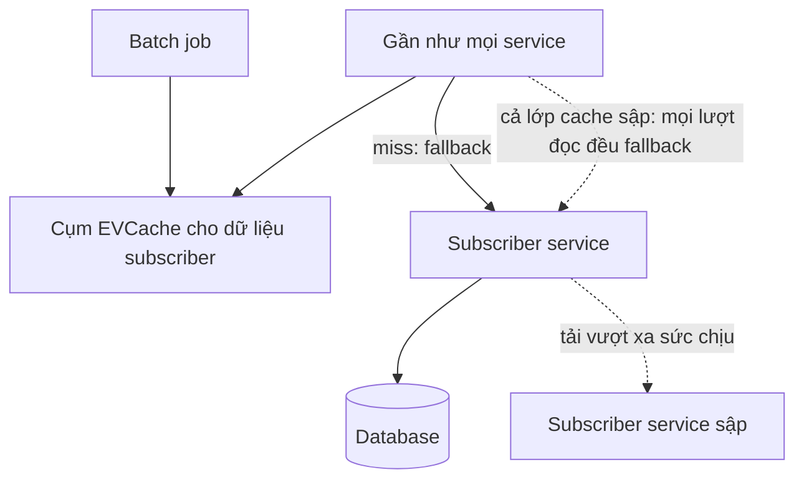

## Mười service tốt ghép thành một sản phẩm kém hơn

Hãy hình dung mười service, cái nào cũng đạt 99,99% thời gian hoạt động, nghĩa là mỗi cái vẫn được phép chết khoảng 53 phút một năm [S1 @17:50]. Đặt cả mười lên đường đi của một request thì những phút xấu ấy cộng dồn. Cả sản phẩm chỉ còn quanh mức ba số 9, cỡ tám đến chín giờ downtime mỗi năm [S1 @18:08]. Từng phần đều xuất sắc, còn tổng thể tệ hơn hẳn.

Đây là phép thử tư duy Josh Evans đưa ra trong bài nói về microservices ở Netflix [S1 @17:48], sau ba năm phụ trách operations engineering (chaos engineering, monitoring, delivery) [S1 @04:10].

Quy mô lúc đó: khoảng 86 triệu thành viên [S1 @05:09], khoảng 190 quốc gia [S1 @05:14], hàng nghìn loại thiết bị, và tất cả chạy trên microservices trên AWS [S1 @05:21].

Viết thành brief cho design review, yêu cầu chức năng rất gọn: thành viên mở app, tìm thứ để xem, dù chỉ là danh sách phim phổ biến, rồi bấm play [S1 @18:32]. Yêu cầu phi chức năng mới khó: luồng đó phải sống khi một service chết, khi bản deploy lỗi lọt ra, và khi cả một region AWS biến mất, mục tiêu Netflix đặt ra sau khi sự cố control plane ELB năm 2012 ở us-east-1 khiến họ không còn đường lui [S1 @24:13] [S1 @24:31]. Nó còn phải chịu nhịp ship liên tục, vì sự cố dồn vào khoảng 9 giờ sáng, lúc kỹ sư bắt đầu đẩy code [S1 @43:49].

Netflix không bắt đầu từ đây. Năm 2000 [S1 @05:41], họ chạy một ứng dụng Java trên một database Oracle lớn duy nhất; database đó sập là mọi thứ sập theo [S1 @07:04]. Microservices là phản ứng với quá khứ ấy: tách trách nhiệm, scale ngang, chia nhỏ khối việc [S1 @08:58]. Phép tính ở trên là hóa đơn của lựa chọn đó. Mỗi lần gọi sang máy khác là thêm một cách hỏng: mạng chậm hoặc nghẽn, phần cứng hư, dependency vừa deploy bản lỗi hoặc chưa được scale đủ [S1 @14:40].

Nút thắt vì vậy không phải CPU hay storage, mà là dependency: một request ngầm dựa vào bao nhiêu service, và chuyện gì xảy ra khi một trong số đó im lặng.

## Phòng thủ từng lời gọi, rồi chỉ test danh sách quan trọng

Không có phòng thủ, một service hỏng có thể lan thành sự cố cho mọi thành viên; nếu bản lỗi đã lên mọi region thì không còn chỗ failover, chỉ còn sửa tại chỗ [S1 @15:07].

Ở mức một lời gọi, câu trả lời của Netflix là Hystrix [S1 @15:34]: timeout và retry có cấu trúc; fallback, chẳng hạn một response tĩnh, để thành viên dùng tiếp thay vì gặp lỗi; thread pool tách biệt để một dependency chậm không chiếm hết thread của bên gọi; và circuit breaker, ngừng gọi dependency cứ thất bại mãi, trả fallback ngay và cho nó thời gian hồi phục [S1 @15:54].

Cấu hình chưa phải bằng chứng, nên Netflix xây FIT, framework tiêm lỗi chạy trên production [S1 @16:42]. FIT làm hỏng request cho giao dịch giả gắn với tài khoản hoặc thiết bị test, rồi cho một tỷ lệ traffic thật [S1 @16:47]. Request mang context, nên lỗi có hiệu lực dù service đích được gọi trực tiếp hay qua nhiều chặng; nó trông như đã chết mà không ai phải tắt thật [S1 @17:05].

Test từng cặp thì nhanh chóng bế tắc: với 100 microservice, mỗi cái phụ thuộc vài cái khác, số tổ hợp lên tới hàng triệu [S1 @17:28]. Và mỗi service nằm trên đường phát video đều lấy bớt số 9.

Lối ra của Netflix là vạch ranh giới. Critical service là số ít service cần cho trải nghiệm cơ bản: mở app, duyệt, bắt đầu phát [S1 @18:25]; còn lại đều là tùy chọn. FIT recipe đưa mọi service không critical vào blacklist cùng lúc, và Netflix đã chạy chúng trên production trong những khoảng ngắn để chắc rằng thành viên vẫn xem được [S1 @18:44]. Theo Evans, cách này đơn giản hơn nhiều so với test từng cặp và đã tìm ra lỗi nghiêm trọng [S1 @19:07].

Đánh đổi có hai mặt. Được: một bài test phủ đúng kịch bản quan trọng nhất, và team ngoài danh sách nhận hợp đồng rõ ràng, sự cố của họ không được làm dừng việc xem phim. Mất: mọi service không critical cần một fallback chạy được thật, và mỗi lần chạy recipe trên production là một canh bạc ngắn, có chủ đích, với traffic thật.

## Khi mất một node là chuyện lớn

Với service stateless, một instance chết nên là chuyện vặt. Autoscaling thay node hỏng và hấp thụ các đợt tăng tải [S1 @26:32], còn Chaos Monkey, công cụ chaos đầu tiên của họ, liên tục chứng minh rằng giết một instance chẳng thay đổi gì [S1 @27:21]. Theo Evans, từ khi có nó, mất một node không còn kéo sập dịch vụ [S1 @27:30].

Service stateful thì ngược lại. Mất một node database hay cache là một sự kiện đáng kể, và dựng node thay thế có thể mất hàng giờ [S1 @28:20]. Tầng service trộn logic nghiệp vụ với nhiều state trong bộ nhớ là thứ khó nhân bản nhất khi lên multi-region, nên Evans khuyên tách ra [S1 @28:01].

Câu chuyện cache thời đầu lên cloud cho thấy mức tệ nhất. Các kỹ sư từ Yahoo mang sang một thiết kế quen thuộc: mỗi khách hàng được gắn cố định vào một node cache riêng, và dữ liệu của họ chỉ nằm ở đúng node đó [S1 @28:43]. Khi đó chưa có cô lập kiểu Hystrix: không bulkhead, không thread pool riêng [S1 @29:05]. Thế là một node chết kéo theo cả Netflix, và khôi phục mất khoảng ba tiếng rưỡi, gồm cả thời gian chờ cache đầy lại [S1 @29:13].

Hai điểm yếu chồng lên nhau: dữ liệu một bản khiến một node trở nên quan trọng, phía gọi thiếu cô lập khiến node đó quan trọng với mọi người. Nếu có cô lập, một node giữ bản duy nhất cũng chỉ cắt khách hàng của chính nó [S1 @28:57].

Thứ thay thế là EVCache, một lớp bọc quanh memcached [S1 @29:51]. Nó vẫn shard dữ liệu, nhưng mỗi lần ghi sẽ rơi vào nhiều node ở các availability zone khác nhau. Đọc thì ưu tiên zone cục bộ cho nhanh, và client có thể đọc sang zone khác khi bản cục bộ không dùng được [S1 @30:03]. Gần như mọi service cần cache ở Netflix đều dùng nó [S1 @30:28]. Cái giá, dù bài nói không nêu, khá dễ thấy: nhiều bản sao cho mỗi object, nhiều lượt ghi hơn cho mỗi cập nhật.

## Khi cache âm thầm trở thành dependency

EVCache chạy tốt đến mức dễ bị coi là hiển nhiên [S1 @30:46]. Nó xử lý khoảng 30 triệu request mỗi giây trên các cụm của Netflix toàn cầu, cỡ 2 nghìn tỷ request mỗi ngày, giữ hàng trăm tỷ object trên hàng chục nghìn instance memcached [S1 @30:52]. Có đủ node thì thời gian phản hồi vẫn ở mức mili giây khi tải tăng [S1 @31:10].

Thành công đó che đi một dependency. Subscriber service, nơi trả lời mọi câu hỏi về thành viên, được gần như mọi service gọi [S1 @31:30]. Cụm EVCache của nó phục vụ cả batch job tính gợi ý lẫn luồng request thời gian thực [S1 @31:40]. Trong cùng một request, một ứng dụng có thể đọc nó nhiều lần, như thể mỗi lần đọc chẳng tốn gì [S1 @31:54]. Lúc cao điểm, kiểu dùng đó dồn 800.000 đến một triệu request mỗi giây về tầng subscriber [S1 @32:05].

Xét từng lần miss, fallback có lý: cache không có giá trị thì đọc từ nguồn. Rắc rối là cùng quy tắc ấy vẫn áp dụng khi cả lớp cache không dùng được, dồn cho service và database mức tải mà chỉ EVCache gánh nổi [S1 @32:19]. Cách đúng trong tình huống đó là fail fast [S1 @32:32]. Thay vào đó, dưới tải quá mức EVCache sập, và kéo theo toàn bộ subscriber service [S1 @32:36].

Các bản sửa nằm ở phía gọi. Tách traffic batch khỏi traffic thời gian thực. Cache theo phạm vi request nghĩa là các lần đọc lặp trong cùng một request dùng lại kết quả lần đầu [S1 @32:44]. Và, như một kế hoạch chưa làm, cấp cho thiết bị token mã hóa đủ thông tin về thành viên để giữ dịch vụ cơ bản khi subscriber service im lặng [S1 @33:03]. Sau đó dùng FIT kiểm tra kết quả dưới tải [S1 @33:27].

Quy tắc chung: fallback đúng cho một lần miss có thể sai khi mọi lần đều miss. Hãy tính fallback theo sức chịu thật của đích nó trỏ tới.

## Thiết kế này tốn gì, và bài nói chưa chứng minh được gì

Client library là đánh đổi chưa ngã ngũ. Lý lẽ ủng hộ rất mạnh: khi 20 hay 30 team phụ thuộc vào một service, có nên để mỗi team tự viết code truy cập [S1 @19:50]? Netflix chọn thư viện dùng chung. Cái giá lộ ra ở API gateway, nơi có thể gọi khoảng 100 service, nên chạy trong process của mình nhiều code mà team gateway không viết: thư viện ngốn heap quá dự kiến, mang bug, hoặc kéo vào transitive dependency xung đột [S1 @20:18] [S1 @21:00]. Evans gọi đó là con dốc trượt về monolith [S1 @20:11]. Hướng lúc đó là làm thư viện mỏng đi chứ không bỏ, và tranh luận vẫn mở [S1 @21:33].

Hạ tầng cũng vậy. Đêm Giáng sinh năm 2012, control plane ELB của AWS gặp sự cố, và vì Netflix đặt mọi thứ ở us-east-1 nên không còn nơi nào để chuyển traffic [S1 @24:13]. Netflix chuyển sang chạy trên ba region AWS, region nào hỏng thì đẩy traffic sang các region còn lại [S1 @24:31]. Việc này kéo vấn đề stateful quay lại: nhân bản dữ liệu giữa region khó nhất với service trộn state và logic [S1 @28:03].

Vài điều cần dè dặt. Đây là lời kể của một kỹ sư vừa rời công ty [S1 @04:33], và có rất ít con số về kết quả: không có tỷ lệ sự cố trước và sau cho Hystrix, FIT hay critical-service recipe. Phép tính mười service là minh họa, và theo cách tôi đọc, nó giả định sự cố không trùng lúc, trong khi sự cố thật thường trùng. Bài nói cũng chỉ là ảnh chụp một thời điểm.

Điều case này xác lập được thì hẹp mà hữu ích. Netflix chấp nhận nhiều service nhỏ như cái giá của tốc độ, rồi dồn công sức về độ tin cậy vào các đường nối giữa chúng: một lời gọi hỏng ra sao, lời gọi nào được phép hỏng, và phía gọi làm gì khi cả một lớp biến mất.
