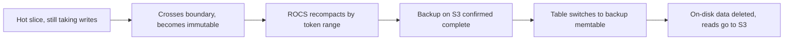

## The problem: old data is expensive and rarely read

The TimeSeries Abstraction is Netflix's platform for storing and querying temporal event data, and it holds the company's largest datasets, spanning multiple petabytes [S1 §Introduction]. Its hot storage is tuned for low-millisecond latency, and keeping everything there is not cheap [S1 §Introduction].

The post lays out the pressures clearly [S1 §Challenges]. Users keep asking for longer retention. Dense clusters that exist only to hold rarely read history are expensive. Most queries touch recent events, yet old data must stay available for audits and investigations. High storage density on hot nodes makes scaling and deploys harder. And sometimes the old data itself needs sub-second answers for internal tools.

As design-review requirements: functionally, users keep calling the same API wherever the data lives. Non-functionally, storage cost must drop sharply, cold data must still be readable in under a second, and cold reads must not disturb the hot path.

## Groundwork: time slices and the immutable boundary

TimeSeries splits each dataset into many tables, each covering a window of time called a time slice [S1 §TimeSeries Abstraction]. Once a slice crosses the write boundary, it becomes immutable. Slice information lives in a metadata table; the control plane creates new slices and maintains the metadata, and the data plane uses it to route reads and writes [S1 §TimeSeries Abstraction].

The point to hold on to: once data never changes again, you are allowed optimizations that live data forbids. The whole story that follows rests on this.

## First answer: Kafka and Flink push data to S3

The first solution followed a familiar streaming pattern: each event was written to Cassandra and also streamed through Kafka and Flink to S3 [S1 §Solution 1: Streaming with Apache Kafka and Flink]. Time Series IDs were hashed into buckets so each Flink task owned a bucket, batched events before writing, and produced Parquet files grouped by event-time hour [S1 §Getting Data Into S3 Efficiently]. Small hourly files are quick to write but slow to read, so one more step was needed.

That step was a daily compaction job merging the small files into one Parquet file per day and namespace [S1 §Compaction Job to Optimize Reads]. Three design choices stand out. Row groups were deliberately small, 4–8 MB, below Parquet's recommended size, because queries are mostly point and range lookups, not full scans. Events inside each row group were sorted by time so range queries avoid blind scans. Bloom filters and file metadata were cached in EVCache so the query planner could skip unnecessary S3 reads [S1 §Compaction Job to Optimize Reads]. Once compaction finished, the matching hot slice was truncated. On the largest datasets the job took about 12 hours, because the team chose lower compute cost over speed [S1 §Compaction Job to Optimize Reads].

On read, the data plane sent the query to both the hot and the cold tier and merged the results; users saw no difference [S1 §Streaming Cold Tier Read]. Thanks to the metadata, reading a full day of data took at most three sequential S3 reads. Latency was about 150 ms at p50 and about 500 ms at p99, and at the time of writing the system served up to 1,250 cold reads per second globally [S1 §Streaming Cold Tier Read].

## Why not stop there

The first solution worked and saved real money: it shrank both Cassandra's EBS footprint and the size of Cassandra backups on S3 [S1 §Why not stop here?]. But the streaming infrastructure was itself expensive and added moving parts the team had to cover on call [S1 §Why not stop here?]. The team asked two questions: could they avoid streaming data into the object store and the transfer cost that comes with it, and could they cut the compute and operational overhead of the new components? That led to a bolder one: could they read directly from the Cassandra backups already sitting on S3 [S1 §Why not stop here?]

This is the central trade-off of the case. The first solution gave cold data a read-optimized format (Parquet, small row groups, Bloom filters) at the price of writing twice and running a separate pipeline. The second reuses what already exists, at the price of deep changes inside Cassandra and accepting the SSTable format, which was never designed for S3.

## Second answer: Cassandra reads its own backups

Netflix already backs Cassandra up to S3 at regular intervals for disaster recovery. The idea is that when a slice qualifies for the cold tier, Cassandra reads straight from the backup and the on-disk copy is deleted, with almost no change to the TimeSeries read path [S1 §Solution 2: Cassandra Cold Storage for Immutable Data]. Making that real meant answering a series of "how" questions.

**Reading backups efficiently.** With common compaction strategies such as LCS or TWCS, SSTables often overlap in token space, so a partition key can be spread over several files and a single point read turns into several lookups [S1 §How Can We Read the Backups Efficiently?]. Netflix wrote a new strategy, ReadOnlyCompactionStrategy (ROCS): once a slice is immutable, it recompacts all SSTables exactly once so they line up precisely with token ranges [S1 §How Can We Read the Backups Efficiently?]. The benefit is not only for the cold tier; touching fewer SSTables per read pulls tail latency down on every tier.

**Knowing what a backup contains.** Each node has a manifest per snapshot listing the S3 path of every SSTable component [S1 §How Would We Leverage Backups?]. Apart from the large `Data.db` file, the index, metadata and integrity files are small, so they can be downloaded to the node at almost no space cost. With them local, Cassandra can plan a query before reading a single byte from S3 [S1 §How Would We Leverage Backups?].

**Letting Cassandra read from S3.** Since Cassandra 4.1, the memtable can be swapped for a custom implementation. Netflix wrote a backup memtable, declared right in the table schema with a timestamp marking the point at which the backup is guaranteed to cover the whole table and the table is immutable [S1 §How Would Cassandra Read From Backups?]. On open, the memtable runs a state machine that pulls the index components down: S3 operations retry with backoff, run on a dedicated thread pool, partially downloaded files are deleted and refetched when their size does not match the manifest, and reads against a memtable still initializing block for at most half the read RPC timeout [S1 §How Would Cassandra Read From Backups?]. To cut S3 calls, the team used larger compression chunks (accepting over-fetch on small reads), disabled read repair because the backup data is immutable, and disabled speculative retries so S3's higher latency does not trigger duplicate reads [S1 §How Would Cassandra Read From Backups?].

**Knowing when it is safe.** Before a memtable points at a backup, the whole ring must confirm two things through Cassandra virtual tables: no ROCS compaction is still running, and the backup has been uploaded for every token [S1 §How Would We Know When It Is Safe To Read From Backups?]. The control plane automates this whole lifecycle, and a slice can sit at any stage without affecting availability, even when backups are delayed or compactions lag [S1 §How Would We Automate This Entire Flow?].

## The cost: CPU, and a separate cluster for cold data

Reading from S3 costs far more CPU than reading local disk. A burst of cold reads could overload the Cassandra cluster and drag the hot path down with it, turning a cost-saving feature into a reliability risk [S1 §How Would Cassandra Handle The Additional Load?]. The safeguard is the option to run cold reads on a separate Cassandra cluster whose backup memtables point at the hot cluster's backups. The cold cluster must match the original's topology but not its hardware, so it can run on small, cheap, storage-light instances [S1 §How Would Cassandra Handle The Additional Load?].

This is a failure mode with the exit designed in: instead of hoping cold reads stay rare, the team can move them off the hot path when needed.

## Results

The Cassandra cold tier was rolled out to the most storage-heavy TimeSeries clusters. It now holds over 15 PB of compressed data, and during the rollout cluster disk usage went from 80% to 7% [S1 §Real World Performance]. It serves thousands of cold reads per second in each region [S1 §Real World Performance]. Against the earlier streaming version, p90 is about 30% better thanks to more efficient S3 access and smaller reads, while p99 stays under about 500 ms; Cassandra's chunk cache still absorbs bursts of cold reads as before [S1 §Real World Performance].

Read these results within their scope. The post gives no savings figure and does not compare the two solutions' costs in numbers; it shows hot disk usage dropping sharply and cold latency not getting worse. The second solution's win is removing an entire pipeline, and its real price is that Netflix has engineers deep enough to change Cassandra's storage engine, which most teams do not.
