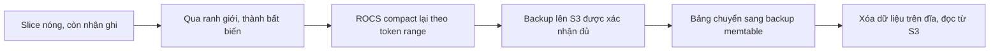

## Bài toán: dữ liệu cũ vừa đắt vừa ít ai đọc

TimeSeries Abstraction là nền tảng Netflix dùng để lưu và truy vấn dữ liệu sự kiện theo thời gian, và nó giữ những tập dữ liệu lớn nhất của công ty, cỡ nhiều petabyte [S1 §Introduction]. Tầng lưu trữ nóng được tinh chỉnh cho độ trễ vài mili giây, và giữ mọi thứ ở đó thì không rẻ [S1 §Introduction].

Bài viết liệt kê áp lực khá rõ [S1 §Challenges]. Người dùng liên tục xin giữ dữ liệu lâu hơn. Cụm dày đặc chỉ để giữ dữ liệu lịch sử ít ai đọc thì đắt. Phần lớn truy vấn chạm sự kiện gần đây, nhưng dữ liệu cũ vẫn phải sẵn sàng cho các đợt audit hay điều tra. Mật độ lưu trữ cao trên node nóng làm việc scale và deploy khó hơn. Và đôi khi chính dữ liệu cũ cũng cần trả lời dưới một giây cho công cụ nội bộ.

Gộp lại thành yêu cầu cho design review: về chức năng, người dùng vẫn gọi đúng một API như cũ, dù dữ liệu nằm ở đâu. Về phi chức năng, chi phí lưu trữ phải giảm mạnh, dữ liệu lạnh vẫn đọc được dưới một giây, và việc đọc lạnh không được làm ảnh hưởng đường nóng.

## Nền tảng: time slice và ranh giới bất biến

TimeSeries chia mỗi tập dữ liệu thành nhiều bảng, mỗi bảng phủ một khung thời gian gọi là time slice [S1 §TimeSeries Abstraction]. Khi một slice đi qua ranh giới ghi, nó trở thành bất biến. Thông tin về các slice nằm trong một bảng metadata; control plane tạo slice mới và giữ metadata, còn data plane dùng metadata đó để định tuyến đọc và ghi [S1 §TimeSeries Abstraction].

Điểm cần nhớ: một khi dữ liệu không bao giờ thay đổi nữa, bạn được phép làm những tối ưu mà dữ liệu sống không cho phép. Toàn bộ câu chuyện phía sau dựa trên điều này.

## Cách thứ nhất: Kafka và Flink đẩy dữ liệu ra S3

Giải pháp đầu tiên đi theo mẫu streaming quen thuộc: mỗi sự kiện vừa ghi vào Cassandra, vừa đi qua Kafka và Flink ra S3 [S1 §Solution 1: Streaming with Apache Kafka and Flink]. Time Series ID được băm vào các bucket để mỗi task Flink lo một bucket, gom nhiều sự kiện lại trước khi ghi, và xuất ra file Parquet nhóm theo giờ của event time [S1 §Getting Data Into S3 Efficiently]. File nhỏ theo giờ thì ghi nhanh nhưng đọc chậm, nên cần thêm một bước.

Bước đó là một job compaction chạy mỗi ngày, gộp file nhỏ thành một file Parquet cho mỗi ngày và mỗi namespace [S1 §Compaction Job to Optimize Reads]. Ba lựa chọn thiết kế đáng chú ý. Row group được cố ý làm nhỏ, 4–8 MB, thấp hơn mức Parquet khuyến nghị, vì truy vấn chủ yếu là tra điểm và tra khoảng chứ không phải quét toàn bộ. Sự kiện trong mỗi row group được sắp theo thời gian để khỏi quét mù. Bloom filter và metadata của file được cache trong EVCache để query planner bỏ qua các lượt đọc S3 không cần thiết [S1 §Compaction Job to Optimize Reads]. Compaction xong thì slice tương ứng ở tầng nóng được truncate. Trên những tập dữ liệu lớn nhất, job này mất khoảng 12 giờ, vì đội ưu tiên chi phí tính toán thấp hơn tốc độ [S1 §Compaction Job to Optimize Reads].

Khi đọc, data plane gửi truy vấn tới cả tầng nóng lẫn tầng lạnh rồi trộn kết quả; người dùng không thấy khác biệt [S1 §Streaming Cold Tier Read]. Nhờ metadata, đọc trọn một ngày dữ liệu cần tối đa ba lượt đọc S3 tuần tự. Độ trễ p50 khoảng 150 ms, p99 khoảng 500 ms, và lúc viết bài hệ thống xử lý tới 1.250 lượt đọc lạnh mỗi giây trên toàn cầu [S1 §Streaming Cold Tier Read].

## Vì sao không dừng ở đó

Cách thứ nhất chạy được và tiết kiệm thật: nó thu nhỏ cả dung lượng EBS của Cassandra lẫn dung lượng backup Cassandra trên S3 [S1 §Why not stop here?]. Nhưng bản thân hạ tầng streaming lại đắt, và thêm nhiều thành phần chuyển động mà đội phải trực on-call [S1 §Why not stop here?]. Đội tự hỏi hai câu: có tránh được việc stream dữ liệu ra object store cùng chi phí truyền dữ liệu đi kèm không, và có giảm được chi phí tính toán và vận hành của các thành phần mới không. Từ đó ra một câu hỏi táo bạo hơn: có đọc thẳng được từ các bản backup Cassandra đã nằm trên S3 không [S1 §Why not stop here?]

Đây là đánh đổi trung tâm của case. Cách thứ nhất cho dữ liệu lạnh một định dạng đọc tối ưu (Parquet, row group nhỏ, Bloom filter), đổi lại phải ghi hai lần và nuôi một pipeline riêng. Cách thứ hai dùng lại thứ đã có, đổi lại phải sửa sâu vào Cassandra và chấp nhận định dạng SSTable vốn không được thiết kế cho S3.

## Cách thứ hai: Cassandra đọc từ chính backup của nó

Netflix vốn backup Cassandra lên S3 định kỳ để phục hồi thảm họa. Ý tưởng là khi một slice đủ điều kiện xuống tầng lạnh, Cassandra đọc thẳng từ bản backup và xóa bản trên đĩa, gần như không phải đổi đường đọc của TimeSeries [S1 §Solution 2: Cassandra Cold Storage for Immutable Data]. Để làm thật, đội phải trả lời một loạt câu hỏi "làm sao".

**Đọc backup cho hiệu quả.** Với các compaction strategy thường dùng như LCS hay TWCS, các SSTable hay chồng lấn nhau trong không gian token, nên một partition key có thể nằm rải trên nhiều file, và một lượt đọc điểm biến thành nhiều lượt tra [S1 §How Can We Read the Backups Efficiently?]. Netflix viết một strategy mới, ReadOnlyCompactionStrategy (ROCS): khi slice đã bất biến, compact lại toàn bộ SSTable đúng một lần sao cho khớp chính xác với các token range [S1 §How Can We Read the Backups Efficiently?]. Lợi ích không chỉ cho tầng lạnh; giảm số SSTable phải chạm khi đọc cũng kéo tail latency xuống ở mọi tầng.

**Biết backup chứa gì.** Mỗi node có một manifest cho mỗi snapshot, liệt kê đường dẫn S3 tới mọi thành phần SSTable [S1 §How Would We Leverage Backups?]. Ngoài file dữ liệu lớn `Data.db`, các file index, metadata và kiểm tra toàn vẹn đều nhỏ, nên có thể tải chúng về node mà gần như không tốn chỗ. Có chúng tại chỗ, Cassandra lập kế hoạch truy vấn trước khi phải đọc một byte nào từ S3 [S1 §How Would We Leverage Backups?].

**Cho Cassandra đọc từ S3.** Từ Cassandra 4.1, memtable có thể thay bằng implementation riêng. Netflix viết một backup memtable, khai báo ngay trong schema của bảng kèm một timestamp, đánh dấu thời điểm bản backup chắc chắn phủ toàn bộ bảng và bảng đã bất biến [S1 §How Would Cassandra Read From Backups?]. Khi mở, memtable chạy một state machine kéo các thành phần index về: thao tác S3 có retry và backoff, chạy trên thread pool riêng, file tải dở bị xóa và tải lại nếu kích thước không khớp manifest, và lượt đọc vào một memtable đang khởi tạo chỉ bị chặn tối đa nửa thời hạn timeout của RPC đọc [S1 §How Would Cassandra Read From Backups?]. Để giảm số lượt gọi S3, đội dùng compression chunk lớn hơn (chấp nhận đọc thừa với truy vấn nhỏ), tắt read repair vì dữ liệu backup đã bất biến, và tắt speculative retry để độ trễ cao của S3 không kích hoạt các lượt đọc trùng [S1 §How Would Cassandra Read From Backups?].

**Biết khi nào an toàn.** Trước khi trỏ memtable vào backup, cả ring phải xác nhận hai điều qua virtual table của Cassandra: không còn compaction ROCS nào đang chạy, và backup đã upload đủ trên mọi token [S1 §How Would We Know When It Is Safe To Read From Backups?]. Control plane tự động hóa cả vòng đời này, và slice có thể ở bất kỳ giai đoạn nào mà không ảnh hưởng tính sẵn sàng, kể cả khi backup đến trễ hay compaction chậm [S1 §How Would We Automate This Entire Flow?].

## Cái giá: CPU và cụm riêng cho dữ liệu lạnh

Đọc từ S3 tốn CPU hơn nhiều so với đọc đĩa cục bộ. Một đợt đọc lạnh dồn dập có thể làm cụm Cassandra quá tải và kéo theo đường nóng, biến tính năng tiết kiệm tiền thành rủi ro độ tin cậy [S1 §How Would Cassandra Handle The Additional Load?]. Cách phòng là cho phép chạy đọc lạnh trên một cụm Cassandra riêng, trỏ backup memtable vào backup của cụm nóng. Cụm lạnh phải cùng topology với cụm gốc nhưng không cần cùng phần cứng, nên có thể dùng máy nhỏ, rẻ, ít ổ [S1 §How Would Cassandra Handle The Additional Load?].

Đây là failure mode được thiết kế sẵn lối thoát: thay vì hy vọng đọc lạnh luôn hiếm, đội tách nó ra khỏi đường nóng khi cần.

## Kết quả

Cold tier Cassandra được triển khai cho các cụm TimeSeries tốn dung lượng nhất. Hiện nó giữ hơn 15 PB dữ liệu nén, và trong lúc rollout mức dùng đĩa của các cụm đi từ 80% xuống 7% [S1 §Real World Performance]. Nó phục vụ hàng nghìn lượt đọc lạnh mỗi giây ở mỗi region [S1 §Real World Performance]. So với bản streaming trước đó, p90 tốt hơn khoảng 30% nhờ cách truy cập S3 hiệu quả hơn và lượt đọc nhỏ hơn, còn p99 giữ dưới khoảng 500 ms; chunk cache của Cassandra vẫn hấp thụ các đợt đọc lạnh dồn dập như trước [S1 §Real World Performance].

Hãy đọc kết quả này với đúng phạm vi của nó. Bài viết không đưa ra con số tiền tiết kiệm, cũng không so chi phí hai cách bằng số; nó cho thấy dung lượng đĩa nóng giảm mạnh và độ trễ lạnh không tệ đi. Phần thắng của cách thứ hai là bỏ được cả một pipeline, và cái giá thật nằm ở chỗ Netflix có người đủ sâu để sửa storage engine của Cassandra, điều mà phần lớn đội không có.
