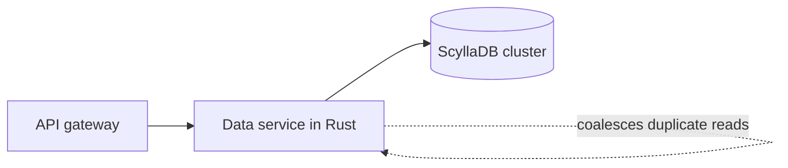

## Where the problem started

Discord is a chat product, and chat is a storage problem wearing a friendly coat. Every message that a person types has to be written down, kept for as long as the person wants it, and read back quickly the moment someone scrolls up. The engineering team described how they handled this in a blog post titled "How Discord Stores Trillions of Messages" [S1]. The story is useful for small teams because it is not really about a clever algorithm. It is about what happens when a perfectly reasonable early decision meets a few years of growth.

In 2017 the messages lived in a Cassandra cluster of 12 nodes [S1]. Cassandra is a wide-column store that spreads data across machines by hashing a partition key, and it was a sensible choice for an append-heavy workload such as messages. Writes are cheap, replication is built in, and adding machines is the standard answer to growth. For a while that answer worked. The cluster grew with the product, and the team kept adding nodes.

By early 2022 the same cluster had 177 nodes [S1]. That number is the first thing worth pausing on. Growing from 12 to 177 machines is not a gentle slope, and each of those machines has to be patched, monitored, replaced and understood. The cluster had stopped being a piece of infrastructure that the team used and had become a piece of infrastructure that the team served. When your database needs a dedicated crew just to stay upright, the economics of the whole product start to bend around it.

## Why a bigger cluster did not make it faster

You might expect that 177 machines would be faster than 12. For raw capacity that was true, but for the latency that users actually feel it was not. The post describes read latency at the 99th percentile swinging between 40 and 125 ms [S1], and inserts at the 99th percentile between 5 and 70 ms [S1]. The word to notice there is "swinging". A p99 is the experience of the unlucky one request in a hundred, and a range that wide means that the unlucky request was very unpredictable.

Two mechanisms explain most of that unpredictability. The first is the hot partition. Messages are stored by channel, so every read for a busy channel lands on the same small set of nodes. When a large community has an active conversation, or when a popular announcement makes thousands of people open the same channel together, one partition receives a disproportionate share of the traffic. That node slows down, and because Cassandra needs several replicas to agree, the slowness spreads to everything that touches that partition. Adding more nodes does not help in this case, because the hot data still lives on the same few of them.

The second mechanism is the runtime. Cassandra runs on the JVM, and the JVM pauses to collect garbage. A pause that is short on average can still be long enough to turn into a visible latency spike at the tail. Under heavy compaction the problem gets worse, because the node is busy rewriting files while it is also trying to serve reads. The post is candid that the team ended up with a cluster that needed constant care: nodes had to be restarted, compactions had to be tuned, and engineers had to be paged to look at machines that were not truly broken, only unhappy [S1]. That kind of work is expensive in a way that never shows up on an invoice.

## The new design: a data service and ScyllaDB

The team did not simply swap one database for another. They changed two things at once, and the second change matters as much as the first. The new design puts a dedicated data service between the API and the database, and it replaces Cassandra with ScyllaDB [S1].

ScyllaDB is a database that speaks the same data model and query language as Cassandra, but it is written in C++ and runs close to the hardware without a garbage collector. For a team in this situation that is attractive for a plain reason: the application code and the data model hardly change, while the part that caused the pauses is gone. It is a migration with a familiar shape, and the risk is concentrated in moving the data rather than in rewriting the product.

The data service is the more interesting half. It is written in Rust, and it sits in front of the database so that product code never talks to the store directly [S1]. Having a single choke point gives the team somewhere to put logic that would be awkward to scatter across every caller. The most important piece of that logic is request coalescing. When several requests arrive for the same row at the same moment, the service lets the first one go to the database and makes the others wait for its answer. A hundred people opening the same channel no longer produce a hundred identical reads. They produce one read and a hundred responses.

The diagram below shows the path a request takes after the change.

Notice what this does to the hot partition problem. The database is still the same shape, and a busy channel is still a busy channel, but the amount of work that reaches the hot partition is no longer proportional to the number of curious users. The service absorbs the burst. That is a cheaper fix than any amount of extra hardware, and it works with any database you might pick later.

## The migration that was supposed to take months

Choosing the destination is only half of a migration. The harder half is getting several years of data there without losing any of it, and without making the product unusable while it moves. The team's first estimate for copying the data was about 3 months [S1]. For a team that is paying for a struggling cluster every day, three months is a long time to wait, and a long time to carry the risk of two systems that must stay in step.

The estimate changed because the team looked at the migrator itself. The first version of the tool was not fast enough, so they rewrote it in Rust, the same language they had chosen for the data service [S1]. The rewrite could sustain up to 3.2 million rows per second [S1]. At that speed the copy finished in about 9 days instead of 3 months [S1]. Nothing about the data had changed. The plan had not become cleverer. The tool had simply stopped being the bottleneck.

This is the lesson that small teams tend to skip. When we plan a migration we think about the schema, the rollout, the rollback and the monitoring. We rarely think about the throughput of the script that does the copying, because a script feels like an afterthought. But a script that runs for three months is a service, and it needs the same performance attention as everything else in the path. Spending a few days making the migrator fast saved the better part of a quarter.

## Cutover and the numbers afterwards

With the data copied, the team still had to switch traffic. The cutover happened in May 2022 [S1]. The post describes it as an anticlimax in the best sense: the result of weeks of preparation was a day on which not much appeared to happen from the point of view of users.

The numbers afterwards are the reason the story gets retold. The cluster went from 177 Cassandra nodes to 72 ScyllaDB nodes [S1]. Fewer than half the machines now carry the same data, which is a direct reduction in what the team has to patch, watch and pay for. Read latency at the 99th percentile dropped from the 40–125 ms range to 15 ms [S1], and insert latency at the 99th percentile settled at 5 ms [S1], compared with the earlier range of 5 to 70 ms. Notice that both improvements are about the tail, not the average. The average request was always fine. The point of the project was to make the bad ones less bad.

It is worth being careful about what these numbers prove. They come from Discord's own account of its own system, and the post is a retrospective written by the people who did the work. They show that the combination of a new database, a data service and a faster migration worked for this workload. They do not show that ScyllaDB is faster than Cassandra in general, and they do not isolate how much of the gain came from the database and how much came from the coalescing in the service. Read the figures as a case, not as a benchmark.

## What a small team can take from it

Most readers of this post do not run a cluster of 177 nodes, and that is exactly why it is worth reading with some care. The first thing to take is the order of operations. Before reaching for a new database, ask whether the load that reaches the old one is load you need to send. Coalescing duplicate reads, caching small hot values and putting a rate limit in front of a popular key are all cheaper than a migration, and they are available to a team of any size.

The second thing is the habit of putting a thin service between product code and storage. It feels like needless indirection when you have one database and one application. It stops feeling that way the first time you need to change the database, add a limit, or find out which callers are responsible for a spike. Discord's data service made the migration safer because it gave them one place to change, instead of every call site in the product [S1].

The third thing is the point about the migrator. If you are planning a data move, put the tool on the schedule as its own piece of work with its own target. Measure how many rows per second it can handle before you commit to a date. The difference between 3 months and 9 days came from that decision [S1], and no amount of careful planning around the edges would have recovered it.

Finally, remember that a database is a team decision as much as a technical one. A system that your on-call engineer can reason about at three in the morning is worth more than one that wins a benchmark, and Discord's own account is a reminder that the cost of a database includes the people who have to keep it alive. The best sign that the migration worked is the least dramatic one: a smaller cluster, a calmer pager, and a service that behaves the same way on a quiet night as it does on a busy one [S1].
