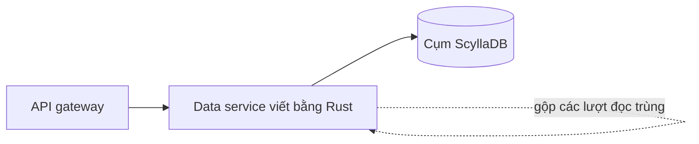

## Vấn đề bắt đầu từ đâu

Discord là sản phẩm chat, và chat thực chất là một bài toán lưu trữ khoác áo thân thiện. Mỗi tin nhắn người dùng gõ ra đều phải được ghi lại, giữ lâu chừng nào người dùng còn muốn, và đọc ngược lại thật nhanh ngay khi ai đó cuộn lên xem. Đội kỹ sư của Discord đã kể lại cách họ xử lý chuyện này trong bài blog "How Discord Stores Trillions of Messages" [S1]. Câu chuyện hữu ích cho các team nhỏ vì nó không thật sự nói về một thuật toán thông minh. Nó nói về chuyện gì xảy ra khi một quyết định ban đầu hoàn toàn hợp lý gặp vài năm tăng trưởng.

Năm 2017, tin nhắn nằm trong một cụm Cassandra gồm 12 node [S1]. Cassandra là một wide-column store, phân tán dữ liệu qua các máy bằng cách băm partition key, và đây là lựa chọn hợp lý cho một khối lượng công việc thiên về ghi nối thêm như tin nhắn. Ghi rẻ, replication có sẵn, và thêm máy là câu trả lời chuẩn cho tăng trưởng. Trong một thời gian, câu trả lời đó vẫn đúng. Cụm lớn lên cùng sản phẩm, và đội cứ thêm node.

Đến đầu năm 2022, cùng cụm đó đã có 177 node [S1]. Con số này là điều đầu tiên đáng dừng lại suy nghĩ. Đi từ 12 lên 177 máy không phải là một con dốc thoai thoải, và mỗi máy trong số đó đều phải được vá lỗi, giám sát, thay thế và hiểu rõ. Cụm database đã thôi là hạ tầng mà đội sử dụng, và trở thành hạ tầng mà đội phải phục vụ. Khi database cần cả một nhóm người chỉ để đứng vững, kinh tế của toàn bộ sản phẩm bắt đầu bị uốn cong quanh nó.

## Vì sao cụm lớn hơn không nhanh hơn

Bạn có thể nghĩ 177 máy sẽ nhanh hơn 12 máy. Về dung lượng thô thì đúng, nhưng với độ trễ mà người dùng thật sự cảm nhận thì không. Bài viết mô tả độ trễ đọc ở phân vị 99 dao động giữa 40 và 125 ms [S1], còn độ trễ insert ở phân vị 99 dao động giữa 5 và 70 ms [S1]. Từ cần chú ý ở đây là "dao động". p99 là trải nghiệm của một request kém may mắn trong mỗi một trăm request, và một khoảng rộng như vậy nghĩa là request kém may mắn đó rất khó đoán.

Hai cơ chế giải thích phần lớn sự khó đoán này. Cơ chế thứ nhất là hot partition. Tin nhắn được lưu theo kênh, nên mọi lượt đọc của một kênh đông người đều rơi vào cùng một nhóm nhỏ các node. Khi một cộng đồng lớn có cuộc trò chuyện sôi nổi, hoặc khi một thông báo nổi bật khiến hàng nghìn người cùng mở một kênh, một partition nhận phần tải lớn hơn hẳn các partition khác. Node đó chậm đi, và vì Cassandra cần nhiều replica đồng thuận, sự chậm lan sang mọi thứ chạm vào partition đó. Thêm node không giúp được trong trường hợp này, vì dữ liệu nóng vẫn nằm trên chính vài node đó.

Cơ chế thứ hai là runtime. Cassandra chạy trên JVM, và JVM thỉnh thoảng dừng lại để dọn rác. Một lần dừng ngắn theo trung bình vẫn có thể đủ dài để biến thành một đỉnh độ trễ ở phần đuôi. Bài viết khá thẳng thắn rằng đội đã có một cụm cần chăm sóc liên tục, và kỹ sư bị gọi dậy để nhìn những cái máy không thật sự hỏng, chỉ là không ổn [S1].

## Thiết kế mới: data service và ScyllaDB

Đội không đơn giản đổi database này lấy database khác. Họ thay đổi hai thứ cùng lúc, và thay đổi thứ hai quan trọng không kém thay đổi thứ nhất. Thiết kế mới đặt một data service chuyên trách giữa API và database, đồng thời thay Cassandra bằng ScyllaDB [S1].

ScyllaDB là database dùng cùng mô hình dữ liệu và ngôn ngữ truy vấn với Cassandra, nhưng được viết bằng C++ và chạy sát phần cứng, không có garbage collector. Với một đội đang ở hoàn cảnh này, điều đó hấp dẫn vì một lý do đơn giản: code ứng dụng và mô hình dữ liệu gần như không đổi, trong khi phần gây ra các lần dừng đã biến mất. Đây là kiểu migrate có hình dạng quen thuộc, và rủi ro tập trung vào việc chuyển dữ liệu chứ không phải viết lại sản phẩm.

Data service mới là nửa thú vị hơn. Nó được viết bằng Rust, và đặt trước database để code sản phẩm không bao giờ nói chuyện trực tiếp với kho dữ liệu [S1]. Có một điểm nghẽn duy nhất cho đội một chỗ để đặt logic mà nếu rải ra mọi nơi gọi thì sẽ rất khó chịu. Phần logic quan trọng nhất là request coalescing. Khi nhiều request cùng đến cho cùng một hàng dữ liệu trong cùng một thời điểm, service cho request đầu tiên đi xuống database và bắt các request còn lại chờ câu trả lời của nó. Một trăm người cùng mở một kênh không còn tạo ra một trăm lượt đọc giống hệt nhau. Chúng tạo ra một lượt đọc và một trăm câu trả lời.

Sơ đồ dưới đây cho thấy đường đi của một request sau thay đổi.

Hãy để ý điều này tác động thế nào lên bài toán hot partition. Database vẫn có hình dạng như cũ, kênh đông người vẫn là kênh đông người, nhưng lượng việc chạm tới partition nóng không còn tỷ lệ thuận với số người dùng tò mò. Service hấp thụ đợt bùng nổ. Đó là cách sửa rẻ hơn bất kỳ lượng phần cứng bổ sung nào, và nó hoạt động với bất kỳ database nào bạn chọn về sau.

## Đợt migrate lẽ ra mất nhiều tháng

Chọn đích đến mới chỉ là một nửa của việc migrate. Nửa khó hơn là đưa dữ liệu tích lũy qua nhiều năm sang đó mà không mất gì, đồng thời không làm sản phẩm ngừng hoạt động trong lúc chuyển. Ước tính đầu tiên của đội cho việc sao chép dữ liệu là khoảng 3 tháng [S1]. Với một đội đang trả tiền mỗi ngày cho một cụm vật vã, ba tháng là rất lâu để chờ, và cũng là rất lâu để mang rủi ro của hai hệ thống phải luôn khớp nhau.

Ước tính thay đổi vì đội nhìn vào chính công cụ migrate. Phiên bản đầu của công cụ chưa đủ nhanh, nên họ viết lại bằng Rust, cùng ngôn ngữ họ đã chọn cho data service [S1]. Bản viết lại duy trì được tới 3,2 triệu hàng mỗi giây [S1]. Ở tốc độ đó, việc sao chép xong trong khoảng 9 ngày thay vì 3 tháng [S1]. Dữ liệu không hề thay đổi. Kế hoạch không trở nên thông minh hơn. Công cụ chỉ đơn giản thôi là nút thắt cổ chai.

Đây là bài học mà các team nhỏ hay bỏ qua. Khi lên kế hoạch migrate, ta nghĩ đến schema, cách rollout, rollback và giám sát. Ta hiếm khi nghĩ đến thông lượng của đoạn script thực hiện việc sao chép, vì script nghe như chuyện phụ. Nhưng một script chạy suốt ba tháng thì chính là một service, và nó cần sự chú ý về hiệu năng như mọi thứ khác trên đường đi. Bỏ ra vài ngày làm cho công cụ migrate nhanh đã tiết kiệm được phần lớn một quý.

## Cutover và các con số sau đó

Khi dữ liệu đã được sao chép xong, đội vẫn phải chuyển lưu lượng. Cutover diễn ra vào tháng 5 năm 2022 [S1]. Bài viết mô tả nó là một khoảnh khắc nhẹ nhàng theo nghĩa tốt nhất: kết quả của nhiều tuần chuẩn bị là một ngày mà dưới góc nhìn người dùng dường như chẳng có gì xảy ra.

Các con số sau đó là lý do câu chuyện này được kể lại nhiều lần. Cụm đi từ 177 node Cassandra xuống 72 node ScyllaDB [S1]. Chưa tới một nửa số máy giờ đây gánh cùng lượng dữ liệu, tức là giảm trực tiếp những gì đội phải vá, theo dõi và trả tiền. Độ trễ đọc ở phân vị 99 giảm từ khoảng 40–125 ms xuống 15 ms [S1], và độ trễ insert ở phân vị 99 ổn định ở 5 ms [S1], so với khoảng 5 đến 70 ms trước đó. Hãy để ý cả hai cải thiện đều nằm ở phần đuôi, không phải ở giá trị trung bình. Request trung bình vốn luôn ổn. Mục tiêu của dự án là làm cho những request xấu bớt xấu đi.

## Một team nhỏ có thể lấy gì từ đây

Phần lớn người đọc bài này không vận hành một cụm 177 node, và đó chính xác là lý do nên đọc kỹ. Điều đầu tiên cần lấy là thứ tự thao tác. Trước khi tìm một database mới, hãy hỏi xem lượng tải đang chạm đến database cũ có phải là tải mình thật sự cần gửi hay không. Gộp các lượt đọc trùng, cache những giá trị nhỏ và nóng, và đặt giới hạn tốc độ trước một key nổi tiếng đều rẻ hơn một đợt migrate, và đội nào cũng làm được, bất kể quy mô.

Điều thứ hai là thói quen đặt một service mỏng giữa code sản phẩm và kho lưu trữ. Khi bạn chỉ có một database và một ứng dụng, nó giống như một lớp gián tiếp thừa. Cảm giác đó biến mất vào lần đầu tiên bạn cần đổi database, thêm một giới hạn, hoặc tìm xem bên gọi nào gây ra một đợt tăng đột biến. Data service của Discord làm cho việc migrate an toàn hơn vì nó cho họ một nơi duy nhất để thay đổi, thay vì mọi điểm gọi trong sản phẩm [S1].

Điều thứ ba là bài học về công cụ migrate. Nếu bạn đang lên kế hoạch chuyển dữ liệu, hãy đưa công cụ vào lịch như một hạng mục riêng với mục tiêu riêng. Hãy đo xem nó xử lý được bao nhiêu hàng mỗi giây trước khi cam kết một ngày hoàn thành. Chênh lệch giữa 3 tháng và 9 ngày đến từ quyết định đó [S1], và không có lượng lên kế hoạch cẩn thận ở các mép nào bù lại được.

Cuối cùng, hãy nhớ rằng chọn database là một quyết định của cả đội chứ không chỉ là quyết định kỹ thuật. Một hệ thống mà kỹ sư on-call có thể suy luận được lúc ba giờ sáng đáng giá hơn một hệ thống thắng benchmark, và lời kể của chính Discord nhắc rằng chi phí của một database bao gồm cả những người phải giữ nó sống. Dấu hiệu tốt nhất cho thấy cuộc migrate thành công lại là dấu hiệu ít kịch tính nhất: một cụm nhỏ hơn, một chiếc pager yên tĩnh hơn, và một dịch vụ hành xử như nhau trong đêm vắng cũng như lúc đông người [S1].
